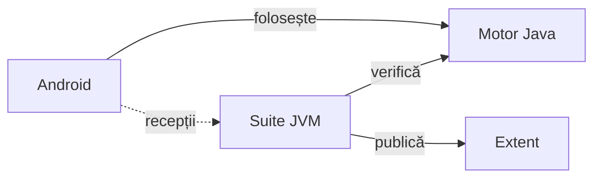

# ATF J7 · Chess Lab

Chess Lab este o aplicație Android de șah: partide cu calculatorul, probleme,
deschideri și o tablă de analiză. J7 deține jocul și testele lui și folosește
bibliotecile ATF pentru verificare și rapoarte Extent.

## Jocul

- [Chess Lab 0.14.0 · ultima ediție publicată](https://github.com/crististefanita/atf_j7/releases/tag/v0.14.0)
- [Descarcă APK Chess Lab 0.14.0](https://github.com/crististefanita/atf_j7/releases/download/v0.14.0/ChessLab-0.14.0.apk)

## Arhitectura J7

| Zonă | Ce deține | Unde aprofundezi |
|---|---|---|
| [`chess-core`](chess-core/src/main) | Reguli, poziții și partide, căutare AI, catalog YAML și progres prin ID-uri stabile. | [Reguli și catalog](docs/board/README.md#reguli-și-probleme) · [Evaluare AI](docs/board/ai-quality.md) |
| [`android`](android/app/src/main) | Meniuri, tablă, accesibilitate și adaptorul pentru salvările locale. Gradle împachetează interfața, motorul și resursele lui în APK. | [Tabla și jocul](docs/board/README.md) |
| [`atf-tests`](atf-tests) | Suite JVM pentru motor și guvernanță; recepțiile instrumentării Android intră în Extent cu aserțiuni și capturi. | [Strategia de testare](docs/testing/README.md) |
| [`release-tools`](release-tools/src/main) | RAG indică documentele și probele afectate. `ReleaseGate` verifică proveniența, calificarea și descărcarea. | [Procesul de release](docs/release/README.md) |
| [`lib`](lib/README.md) | Perechile JAR/POM ATF și contractul lor de consum. Maven le folosește pe traseul JVM. | [Proveniența bibliotecilor](lib/README.md#proveniență) |

- **Gradle** declară `:app` și include `chess-core/src/main/java` și `chess-core/src/main/resources` în build-ul Android.
- **Maven** declară `atf-tests` ca singur modul al reactorului. Acesta compilează `chess-core/src/main/java` și `release-tools/src/main/java` și încarcă `chess-core/src/main/resources`.
- **Biblioteci ATF** în JVM. `atf-reporting` și `atf-test-kit` sunt dependențe Maven cu scope `test`.

Legendă — codul jocului și traseul dovezilor

- Gradle declară aplicația `:app`. Atât aplicația, cât și reactorul Maven citesc
  sursele din `chess-core`. Maven declară `atf-tests` ca modul și compilează
  `release-tools` ca surse adăugate.
- Linia punctată arată recepțiile produse de instrumentarea Android. Testele
  de componentă rulează în JVM; publicarea recepțiilor completează proba nativă.
- Extent folosește ATF Reporting din `lib`. Numele versiunii, APK-ul și dovada
  de publicare se reconciliază în [catalogul edițiilor](release/README.md).

## Puncte de intrare

- [Documentația proiectului](docs/README.md) — alege ghidul după zona schimbată.
- [Strategia de testare](docs/testing/README.md#alegerea-nivelului) — alege componentă, guvernanță sau sanity Android.
- [Procesul de release](docs/release/README.md#calificare-și-publicare) — construiește și califică ediția în TMP.
- [Feedback activ](docs/feedback/README.md) — urmărește lacunele și criteriile de închidere.
