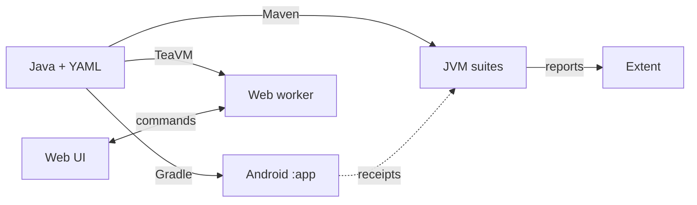

# Chess Lab

Play chess against AI, solve puzzles, and study openings.

## Play

- [Download Chess Lab 0.16.1 APK](https://github.com/crististefanita/chess/releases/download/v0.16.1/ChessLab-0.16.1.apk)
- [Play in your browser](https://crististefanita.github.io/chess/)

## Chess Architecture

| Area | What it owns | Where to learn more |
|---|---|---|
| [`chess-core`](chess-core/src/main) | Rules, positions and games, AI search, the YAML catalog, and progress tracked by stable IDs. | [Rules and catalog](docs/board/README.md#rules-and-puzzles) · [AI evaluation](docs/board/ai-quality.md) |
| [`android`](android/app/src/main) | Menus, board, accessibility, and the adapter for local saves. Gradle packages the UI, engine, and engine resources in the APK. | [Board and gameplay](docs/board/README.md) |
| [`web`](web) | Browser UI, local storage, and the TeaVM worker that runs the chess engine. | [Build and APK–Web parity](web/README.md) |
| [`atf-tests`](atf-tests) | JVM suites for the engine and governance. Android instrumentation receipts are published in Extent with assertions and screenshots. | [Testing strategy](docs/testing/README.md) |
| [`release-tools`](release-tools/src/main) | RAG identifies affected documents and checks. `ReleaseGate` verifies provenance, qualification, and download. | [Release process](docs/release/README.md) |
| [`lib`](lib/README.md) | The ATF JAR/POM pairs and their consumption contract. Maven uses them for the JVM suites. | [Library provenance](lib/README.md#provenance) |

- **Gradle** declares `:app` and includes `chess-core/src/main/java` and `chess-core/src/main/resources` in the Android build.
- **Maven** declares `atf-tests` as its only reactor module. It compiles `chess-core/src/main/java` and `release-tools/src/main/java` and loads `chess-core/src/main/resources`.
- **ATF libraries** on the JVM. `atf-reporting` and `atf-test-kit` are Maven dependencies with `test` scope.

Legend — game code and evidence flow

- Gradle declares the `:app` application. Both the application and the Maven
  reactor read the sources in `chess-core`. Maven declares `atf-tests` as a
  module and compiles `release-tools` as an additional source directory.
- The dotted line shows the receipts produced by Android instrumentation. Component
  tests run on the JVM. Publishing the receipts completes the native evidence.
- The browser sends moves to the worker. Shared worker contract tests compare resumption and
  results with the JVM engine.
- Extent uses ATF Reporting from `lib`. The version name, APK, and publication
  evidence are reconciled in the [release catalog](release/README.md).

## Published Release

- [Chess Lab 0.16.1 · release notes](https://github.com/crististefanita/chess/releases/tag/v0.16.1)

## Entry Points

- [Project documentation](docs/README.md) — find the guide for the area you changed.
- [Testing strategy](docs/testing/README.md#choosing-the-test-level) — choose component testing, governance, or Android sanity.
- [Release process](docs/release/README.md#qualification-and-publication) — build and qualify the release in TMP.
- [Active feedback](docs/feedback/README.md) — track gaps and closure criteria.
