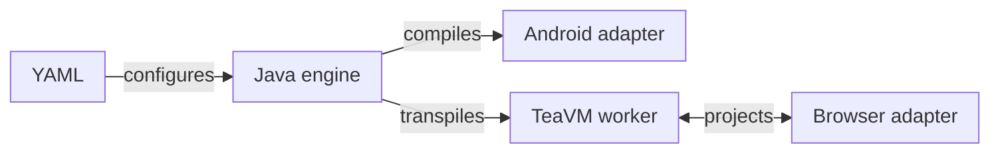
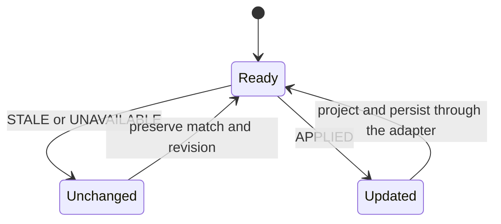
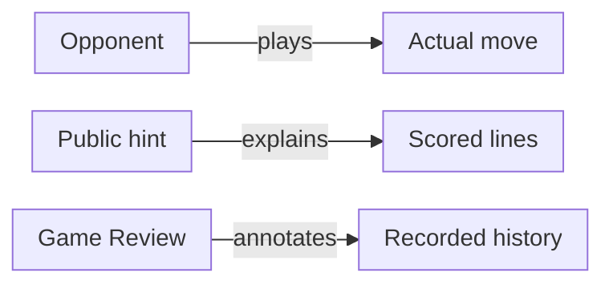
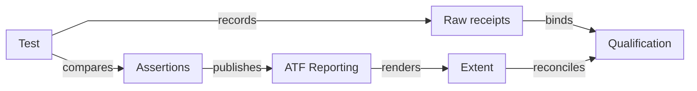

# Chess Lab Architecture Atlas

## Overview

Use this map to identify the owner, shared contract and executable evidence before changing a feature.
[Project structure](../README.md#chess-architecture) · [Testing strategy](testing/README.md) · [Open gaps](feedback/README.md)

## Engine and Platform Boundaries

The Java rules and YAML catalogs are shared inputs. Android and Web own their rendering, platform storage and lifecycle adapters.

Legend — shared behavior, separate adapters

- `chess-core` owns positions, legal moves, sessions, catalog identity and serializable state. Build declarations include its Java and resources in Android and the Web worker.
- Android owns native views and preferences. Web owns DOM/Canvas/SVG, browser storage and worker messaging. The same UI decision can have different platform code.
- Shared component fixtures protect positions, cursor transitions and geometry. A JVM PASS does not prove Android rendering or a successful TeaVM build.
- The served bundle manifest identifies the actual Web engine. An older qualified worker cannot certify parity with a newer APK.

## Session Changes and Resumption

An accepted command advances the recorded game and its revision. A stale or unavailable command preserves both.

Legend — command identity and persistence

- [`ChessGameSession`](../chess-core/src/main/java/ro/atf/chess/ChessGameSession.java) checks the expected revision before applying a player or bot move. Legality, the game result and the acting side still constrain the command.
- The adapter owns persistence and delayed work. Receiving a reply does not authorize applying it to another position or slot.
- [`MatchStore`](../chess-core/src/main/java/ro/atf/chess/MatchStore.java) and the platform preferences preserve recorded games. [`GameReviewSession`](../chess-core/src/main/java/ro/atf/chess/GameReviewSession.java) owns review navigation; inspecting a variation must preserve its source history.
- Components check restoration with real codecs and in-memory preferences. A real process restart and platform focus remain native integration evidence.

## Opponent, Hint and Review

These callers answer different questions. A legal recorded line proves neither optimal play nor an independently measured rating.

Legend — separate decisions and quality verdicts

- [`MatchAiPolicy`](../chess-core/src/main/java/ro/atf/chess/MatchAiPolicy.java) and the YAML policies define the opponent and analysis allowances. Preserve their actual work receipts when comparing results.
- A Basic or Advanced move remains that profile's decision when Hard shadow analysis or a public hint is also observed.
- The hint compares candidate lines and their replies. Game Review evaluates the recorded game with its own configured allowance. A failed proof must not invent a final score or a completed recommendation.
- [AI quality](board/ai-quality.md) owns search semantics. [Native status](testing/hard-status.md) distinguishes accepted objectives, independent oracle findings and uncertainty in the rating protocol.

## Evidence and Qualification

The test evaluates the comparison once. Reporting publishes that result; qualification reconciles its exact identity and inventory with the execution receipts.

Legend — source, verdict and rendered evidence

- [`Checks`](../atf-tests/src/test/java/ro/atf/chess/Checks.java) and [`ExtentAudit`](../atf-tests/src/test/java/ro/atf/chess/ExtentAudit.java) retain expected/actual values, failures and the real lifecycle phases. Assertion steps are not synthetic HTTP requests or browser actions.
- Reporting and Test Kit are binary dependencies from `lib`; their implementations and native governance remain at their library owner.
- `ComponentQualification` checks commit, run, suite and the exact testcase set in Surefire and Extent. Native qualification additionally binds the signed APK, device phases and captured PNGs.
- Static artifact inspection needs an independently declared evidence profile. Browser checks address the live selected owner and disclosure, not hidden templates or another projected view.
- A component proof does not substitute for native or Web rendering. [Release qualification](release/README.md#qualification-and-publication) owns the promotion decision; RAG stays advisory.

## Owner and Test Map

| Decision | Source owner | Focused evidence |
|---|---|---|
| Rules and catalog | `ChessPosition`, `QuestCatalog` | `ChessComponentTest`, `QuestCatalogTest` |
| Guarded moves and saved games | `ChessGameSession`, `MatchStore` | `ChessGameSessionTest`, `MatchStoreTest` |
| Review cursor and source history | `GameReviewSession` | `GameReviewSessionTest`, `GameReviewTimelineTest` |
| Shared board and arrow geometry | `BoardPanelLayout`, `HintArrow` | `BoardPanelLayoutTest`, `HintArrowTest`, `MatchAnalysisParityTest` |
| Component result and publication | `Checks`, `ExtentAudit`, `ComponentQualification` | `ExtentGovernanceTest`, `ReleaseGovernanceTest` |
| Advisory routes and delivery | `ReleaseRag`, `ReleaseGate` | `GeometryRagGovernanceTest`, `ReleaseGovernanceTest` |
| Documentation shape and meaning | Area guide, `MarkdownVisualContract`, `DocumentationPair` | `MarkdownDiagramGovernanceTest`, `DocumentationGovernanceTest`, paired review |

## Change Checklist

1. Read the source owner, its guide and the active closure criteria. Identify the actual Git baseline and preserve parallel work.
2. Choose the smallest component or governance check that observes the changed contract. Keep indispensable native or Web sanity separate.
3. Build in a fresh TMP staging area. Keep raw receipts, the exact test selection and audit output tied to that candidate.
4. Review diagram meaning, examples and links in English and Romanian. The paired gate protects structure; semantic review still owns translation accuracy.
5. Promote only qualified source and evidence. Move a stable rule into its owner guide before removing the resolved feedback item.
