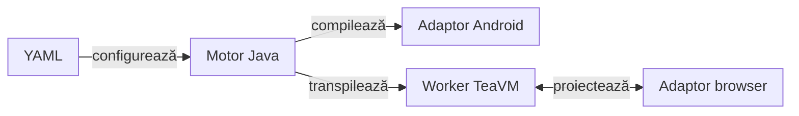
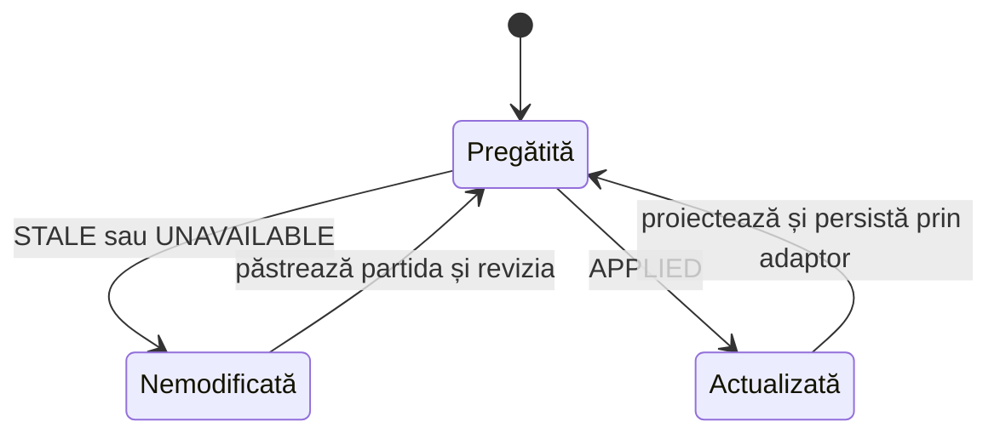
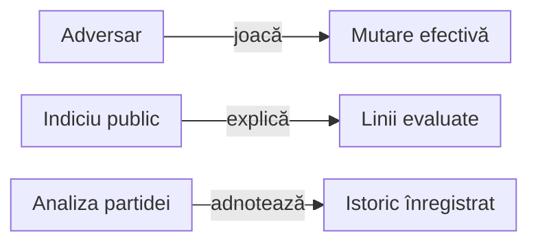
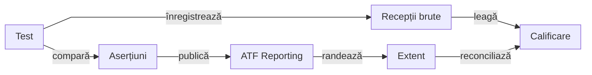

# Atlasul arhitecturii Chess Lab

## Pe scurt

Folosiți harta pentru a identifica ownerul, contractul comun și dovada executabilă înaintea unei schimbări.
[Structura proiectului](../README.md#arhitectura-chess) · [Strategia de testare](testing/README.md) · [Lacune deschise](feedback/README.md)

## Motorul și limitele platformelor

Regulile Java și cataloagele YAML sunt intrări comune. Android și Web dețin adaptoarele pentru randare, stocare și ciclul de viață al platformei.

Legendă — comportament comun, adaptoare separate

- `chess-core` deține pozițiile, mutările legale, sesiunile, identitatea catalogului și starea serializabilă. Declarațiile de build includ Java și resursele sale în Android și în workerul Web.
- Android deține view-urile native și preferințele. Web deține DOM/Canvas/SVG, stocarea browserului și mesajele workerului. Aceeași decizie UI poate avea cod diferit pe fiecare platformă.
- Fixture-urile comune de componentă protejează pozițiile, tranzițiile cursorului și geometria. Un PASS JVM nu dovedește randarea Android sau un build TeaVM reușit.
- Manifestul bundle-ului servit identifică motorul Web efectiv. Un worker vechi calificat nu certifică paritatea cu un APK mai nou.

## Schimbarea și reluarea sesiunii

O comandă acceptată avansează partida înregistrată și revizia. O comandă expirată sau indisponibilă le păstrează pe ambele.

Legendă — identitatea comenzii și persistența

- [`ChessGameSession`](../chess-core/src/main/java/ro/atf/chess/ChessGameSession.java) verifică revizia așteptată înaintea mutării jucătorului sau botului. Legalitatea, rezultatul partidei și partea la mutare continuă să limiteze comanda.
- Adaptorul deține persistența și lucrul amânat. Primirea unei replici nu autorizează aplicarea ei la altă poziție sau în alt slot.
- [`MatchStore`](../chess-core/src/main/java/ro/atf/chess/MatchStore.java) și preferințele platformei păstrează partidele înregistrate. [`GameReviewSession`](../chess-core/src/main/java/ro/atf/chess/GameReviewSession.java) deține navigarea analizei; inspectarea unei variante păstrează istoricul sursă.
- Componentele verifică restaurarea cu codec-urile reale și preferințe în memorie. Restartul real de proces și focusul platformei rămân dovezi de integrare nativă.

## Adversarul, indiciul și analiza

Acești calleri răspund unor întrebări diferite. O linie legală înregistrată nu dovedește joc optim sau un rating măsurat independent.

Legendă — decizii și verdicturi de calitate separate

- [`MatchAiPolicy`](../chess-core/src/main/java/ro/atf/chess/MatchAiPolicy.java) și politicile YAML definesc alocațiile adversarului și analizei. Păstrați recepțiile lucrului efectiv la compararea rezultatelor.
- O mutare Basic sau Advanced rămâne decizia acelui profil când se observă și analiza Hard shadow sau un indiciu public.
- Indiciul compară liniile candidate și replicile lor. Game Review evaluează partida înregistrată cu propria alocație configurată. O dovadă incompletă nu inventează un scor final sau o recomandare completată.
- [Calitatea AI](board/ai-quality.md) deține semantica de căutare. [Statusul nativ](testing/hard-status.md) distinge obiectivele acceptate, constatările oracolului independent și incertitudinea protocolului de rating.

## Dovezi și calificare

Testul evaluează comparația o singură dată. Reporting publică rezultatul; calificarea reconciliază identitatea și inventarul exact cu recepțiile execuției.

Legendă — sursa, verdictul și dovada randată

- [`Checks`](../atf-tests/src/test/java/ro/atf/chess/Checks.java) și [`ExtentAudit`](../atf-tests/src/test/java/ro/atf/chess/ExtentAudit.java) păstrează valorile așteptate/observate, eșecurile și fazele reale ale ciclului de viață. Pașii de aserțiuni nu sunt request-uri HTTP sau acțiuni browser sintetice.
- Reporting și Test Kit sunt dependențe binare din `lib`; implementările și guvernanța lor nativă rămân la ownerul bibliotecii.
- `ComponentQualification` verifică commitul, rularea, suita și setul exact de cazuri în Surefire și Extent. Calificarea nativă leagă suplimentar APK-ul semnat, fazele dispozitivului și PNG-urile capturate.
- Inspecția statică a artefactului cere un profil de dovezi declarat independent. Probele browser urmăresc ownerul și disclosure-ul selectat live, nu template-urile ascunse sau altă proiecție.
- O probă de componentă nu înlocuiește randarea nativă sau Web. [Calificarea ediției](release/README.md#calificare-și-publicare) deține promovarea; RAG rămâne consultativ.

## Harta ownerilor și a testelor

| Decizie | Owner sursă | Dovadă focalizată |
|---|---|---|
| Reguli și catalog | `ChessPosition`, `QuestCatalog` | `ChessComponentTest`, `QuestCatalogTest` |
| Mutări controlate și partide salvate | `ChessGameSession`, `MatchStore` | `ChessGameSessionTest`, `MatchStoreTest` |
| Cursorul analizei și istoricul sursă | `GameReviewSession` | `GameReviewSessionTest`, `GameReviewTimelineTest` |
| Geometria comună a tablei și săgeții | `BoardPanelLayout`, `HintArrow` | `BoardPanelLayoutTest`, `HintArrowTest`, `MatchAnalysisParityTest` |
| Rezultatul și publicarea componentelor | `Checks`, `ExtentAudit`, `ComponentQualification` | `ExtentGovernanceTest`, `ReleaseGovernanceTest` |
| Rute consultative și livrare | `ReleaseRag`, `ReleaseGate` | `GeometryRagGovernanceTest`, `ReleaseGovernanceTest` |
| Forma și sensul documentației | Ghidul ariei, `MarkdownVisualContract`, `DocumentationPair` | `MarkdownDiagramGovernanceTest`, `DocumentationGovernanceTest`, revizuirea perechii |

## Lista schimbării

1. Citiți ownerul sursă, ghidul și criteriile active de închidere. Identificați baza Git efectivă și păstrați lucrările paralele.
2. Alegeți cea mai mică probă de componentă sau guvernanță care observă contractul schimbat. Păstrați separat sanity-ul nativ sau Web indispensabil.
3. Construiți într-un staging TMP nou. Legați de candidat recepțiile brute, selecția exactă de teste și auditul rezultat.
4. Revizuiți sensul diagramelor, exemplele și legăturile în engleză și română. Poarta perechii protejează structura; revizuirea semantică păstrează responsabilitatea traducerii corecte.
5. Promovați numai sursa și dovezile calificate. Mutați regula stabilă în ghidul ownerului înainte de a elimina feedback-ul închis.
