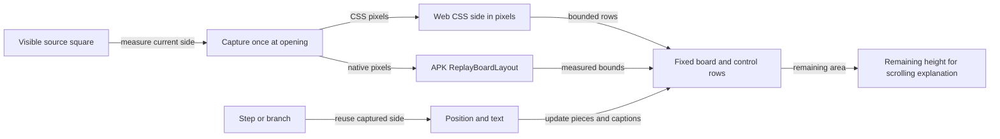

# The Chessboard

## Overview

- **Scope.** The shared engine owns move legality. Android and Web render that position through their own adapters. [Web adapter and shared contract](../../web/README.md)
- **Checks.** `BoardPanelLayoutTest` checks geometry, `QuestHintTest` checks hints, and `MatchActionsTest` checks game commands. `ChessWebQuestStudyTest` checks the study controls without Android.
- **Start here.** [Puzzles](#tactics-and-points) · [Analysis board](#analysis-board) · [Game against the computer](#game-against-the-computer).

## Tactics and points

- In **Tactics**, look for the move that wins material or starts a combination. When the exercise has a playable continuation, the opponent replies on the board and you play through to the last move. **Tactic explained** shows the line, captured pieces, and material change. In exercises that end after the key move, **Defense study** can show what follows the reply chosen by Stockfish.
- In **Puzzles → Tactical training** you will find 114 positions, including rook combinations, intermediate moves, and promotions prepared by a sacrifice. Progress and points are kept when you return to the chapter. [Catalog and verification](quest-curation.md#tactical-training-and-verification-set)
- In **Puzzles → In-between move**, look for the forcing check or capture before recapturing. The chapter increases in difficulty in three tiers. [Catalog and scoring](quest-curation.md#intermediate-move)
- The control below the board shows the piece with a lightbulb, the move with an arrow, and the explanation with a book. You can tap the icon or the label. The target is 48 dp, and **Waiting** appears while the opponent replies.
- The first solution to each puzzle awards 10 points. A streak without mistakes or hints adds 2 points for each puzzle, starting with the second, up to 20 points per puzzle. The flame shows the streak length and carries across chapters.
- A mistake or a request for a hint ends the streak. Solving that puzzle still qualifies for the 10 base points. Revisiting and resuming preserve points already awarded. Puzzles solved before this change receive the base credit.

- The point system and the bonus from the second solution follow the Puzzle Points model. In Chess Lab, the flame represents consecutive puzzles solved without help. [Chess.com Puzzle Points](https://support.chess.com/en/articles/9681952-what-are-puzzle-points-on-chess-com)

## Board and hints

- Green and cream squares frame the Staunton pieces. The open notch and
  taller silhouette distinguish the bishop from the pawn. Coordinates sit on
  the edge, and the last move marks both origin and destination.
- When you enter a chapter, the side solving the puzzle starts at the bottom. **Previous** and **Next** keep the orientation and coordinates. The side-to-move marker follows the active color. Use **Flip board** to change orientation.
- Labels and messages have reserved space. At the same window size and font scale, the board keeps its position and size when the puzzle, history move, or analysis changes. In short windows, the board stays square and shrinks to leave room for the controls.
- In puzzles and **Explain**, the board uses all available width when it fits vertically. The message and progress are below the board. If space is short, the details area can scroll while the controls stay visible.
- Tapping an active piece shows only legal destinations. A second tap selects the destination. Promotion requires an explicit choice.
- Each square can receive focus and announces its coordinate, piece, and legal destination when available. The status bar announces whose turn it is and the result detected by the engine.
- A wrong attempt preserves the position. If the move gives check, the app shows the opponent's reply and the following response, plus the net material gain or the result when the line ends in checkmate or stalemate. When several replies have the same score, the message shows how many there are and identifies an alternative. Tap the message to read it in full. An immediate stalemate has its own message.
- In Mate in 2 and Mate in 3, the correct move appears immediately. The reference defense follows after 650 ms while the board is in the foreground. During the pause, the marker shows the opposing color to move, and the board and hints wait for the reply. The marker then returns to the player and the last move highlights the defense.

### Hint and explanation controls

- **Hint** marks the piece's square with a subtle turquoise outline and announces its name and coordinate. **Show move** adds a thin arrow and the text “Suggested move,” including the required piece for promotion. The cells announce the cues in text, and the arrow follows the coordinates when the board is flipped. After the defense, the hint starts from the new position.
- The arrow's geometric tip ends 12% of the square's side length before the destination's center, along the move's direction. The origin, head size and width keep the same proportions on APK and Web. Android uses the measured cell centers through [`HintArrow`](../../chess-core/src/main/java/ro/atf/chess/HintArrow.java), including when integer pixel rounding gives adjacent cells slightly different widths.
- The screen reader announces the color and piece for **Hint**, then includes the destination for **Show move**. When you reach a milestone, the checkmate confirmation also announces it. The progress bar keeps the milestone visible when you return.
- In **Mate in 1**, **Explain** opens the checkmate position on a separate board. In **Mate in 2** and **Mate in 3**, the arrows navigate the line one ply at a time. While solving, the line starts at the current position. After solving, it starts from the beginning and shows the played finish, including an accepted alternative mate. The last step explains the check and the escape squares.
- In the explanation, the current move appears first below the fixed board, above the scrollable reason. **Danger**, between the arrows, outlines the mated king or the captured piece's square and announces the reason. For a capture, it calculates the minimum material gain that remains after any legal reply. A recapture that removes the gain, an opposing checkmate, and stalemate suppress the marker. The arrows clear it whenever the position changes. The **OK** button in the header returns to the puzzle with progress and points preserved.

- The two-step hint model follows Daily Puzzle. The explanation remains a separate action, as does explicitly revealing the solution in Lichess Training. [Chess.com Daily Puzzle](https://support.chess.com/en/articles/8708990-how-does-the-daily-puzzle-work) · [Lichess Puzzle Training](https://lichess.org/training/daily)

### Source-sized replay

Calculated line, Mating line and AI/theory previews capture the visible source
square when they open. Navigation changes pieces and text without measuring
the preview as a new source. Reopening captures the current source again.
`MatchViewport` selects compact native seat rows on narrow portrait windows
and windows up to 480 dp high, leaving more height for the same square.

Legend · Source, adapters and fixed rows

- Web stores `--replay-board-side`; fixed rows prevent text from overlapping
  the square or arrows. The standard AI hint row and continuation slot reserve
  their space before an action. Short-window metadata shares one line. Replay
  columns use `minmax(0, 1fr)` so an explanation scrollbar cannot widen the
  board's track and shift its center between steps.
- Android passes `board.getWidth()` through `MatchAnalysisView` and the puzzle
  replay entry. `ReplayBoardLayout` keeps that measured side, allocates fixed
  controls, then gives the remainder to the explanation. A rotated or narrower
  window clamps the square to the new usable area; an unmeasured source uses
  a bounded fallback. The general Game Review layout keeps its own policy.
- Compare usable CSS pixels and native logical units, including each platform's
  insets. The contract is equivalent presentation and stable navigation, not
  identical raw pixels across displays. Components qualify the calculation;
  native sanity qualifies actual APK rendering. [Verification](../testing/README.md#analysis-in-the-ai-game)

## Rules and puzzles

- [`chess-rules.yaml`](../../chess-core/src/main/resources/chess-rules.yaml) declares piece vectors, sliding or jumping movement, pawn direction, captures, promotion, and the setup for both types of castling. The engine applies obstacles, alternating turns, king safety, and expiry of en passant rights. The safety conditions remain mandatory when loading the standard profile.

- [`tactical-analysis.yaml`](../../chess-core/src/main/resources/tactical-analysis.yaml) limits the horizon to at most three plies. The in-game message uses two, starting with the opponent's reply. Each side chooses its own best continuation. Checkmate takes precedence, stalemate scores zero, and other positions are compared by material at the end of the line. The displayed gain is the material difference from the position after the player's attempt. Scores tied at this horizon stay in one group, and UCI ordering determines the displayed line. Repetition, the no-capture or pawn-move rule, and positional evaluation require an analysis with history and a longer horizon.

- [`quests.yaml`](../../chess-core/src/main/resources/quests.yaml) stores the FEN position, UCI solution, and theme of each puzzle. The set has 500 positions, 250 with each color to move. The catalog includes compositions with castling mate, en passant, promotion to a knight, and defense while in check.

| ID | Hint | Solution |
|---|---|---|
| `mate-101` | Bishop on `h6` | `Nd2#` answers the black rook's check and opens the h-file for White's queen. |
| `mate-102` | Pawn on `h3` | `hxg4#` captures the checking knight and clears the h-file for White's rook. |

- [`mate-in-two.yaml`](../../chess-core/src/main/resources/mate-in-two.yaml) has 300 positions with a single first move that forces mate. After that move, the app plays the reference defense and accepts any legal mate from the resulting position. Hints follow the current move, and the explanation shows the full line. [Selection and provenance](quest-curation.md#mate-in-two-moves)

- [`mate-in-three.yaml`](../../chess-core/src/main/resources/mate-in-three.yaml) contains 200 positions with mate in exactly three and a single winning first move. The game applies the two reference defenses, shows how many moves remain after the first defense, and accepts any legal mate on the last move. [Selection and provenance](quest-curation.md#mate-in-three-moves)

- [`tactics.yaml`](../../chess-core/src/main/resources/tactics.yaml) adds 100 positions with a single move that wins material within the chapter's horizon. The selection covers forks, pins, discovered attacks, and deflections.

## Analysis board

- From the main menu you start from the initial position. In a game, the magnifier next to history opens the exact displayed position and keeps the game's moves available for navigation.
- You play both White and Black manually. Evaluation updates locally for each position, and the lightbulb shows a continuation. The arrows and moves in the strip select positions. A different move replaces the board's continuation, while **Reset line** restores the position and continuation from entry.
- While the position has theory continuations, the lightbulb offers up to three complete lines. Below the board you can see **Theory**, the line number, and the opening name. Tap the label for full-screen replay. The arrows navigate moves by both colors, the board keeps its position, and each step's explanation scrolls separately. Two lines can start with the same move. The YAML lessons take priority, and the ECO index supplies continuations when the lessons do not cover the position. When a position has no documented continuations, the lightbulb returns to engine analysis. A transposition or going back in history may bring theory back.
- After showing a variation, tap the arrow's destination directly to play its first move, including the indicated promotion. If you select a piece after showing the hint, you choose the move as usual. From a playable historical position, the move applies to the study line.
- After resignation or a draw by agreement, the final position remains playable in analysis. Checkmate and automatic endings remain terminal. You can explore from an earlier position.
- In **Analysis board options**, the **AI analysis** checkbox controls the bar, the lightbulb, and **Review all moves**. The report traverses the entire current line, even if the arrows have taken you to an earlier position. It compares White and Black using the graph, move categories, and accuracy. From any move's details you can return to the board or start from the position before the move.
- When the line preserves the moves of a finished game, the same command opens **Game review**, with the player, AI, graph, every move, and the available Elo estimates. If the game has a place in the archive, the report is saved there. An edited branch or a manually played line remains a study by color, with accuracy and categories.
- **Continue as a saved game** keeps the history up to the selected position and uses an empty slot out of ten. Select **Let AI play its moves** for automatic replies. Clear it to play both colors. The game you entered study from keeps its saved state. When all slots are occupied, the board keeps the line open. A continuation that starts with a study prefix retains the graph and accuracy at the end, with Elo unavailable for that line.

- Navigation and manual play for both colors follow the individual analysis flow. [Chess.com Analysis Board](https://support.chess.com/en/articles/8583825-how-do-i-use-the-analysis-board)

## Game against the computer

- The main menu groups **New game**, **Saved games**, and **Finished games** under **Games**. Puzzles, openings, and the analysis board are in **Study**, and the player's name is in **Profile**. Both game lists open as dedicated screens in the style of the **Puzzles** menu. **Back** stays visible while you scroll and returns to the screen you came from.

### Browse saved and finished games

- **Finished games** keeps the ten most recent results in order of completion, newest first. You can reopen the board and move history for any game. If you let analysis finish, the list marks it as saved, and **📊 Game review** opens it directly. A continuation from the archive uses an empty slot and preserves the original result. When the eleventh result arrives, the oldest result and its analysis leave the archive.

- **Saved games** shows only games in progress, up to ten, newest first by start time. When a game ends, it moves to **Finished games** in the same save. **New game** uses the first empty slot and can then reuse the slot of an archived game. When all slots contain active games, setup announces that the oldest saved game will be replaced. Resuming a game keeps its place in that order. For saves from earlier editions, the initial order follows slot number.

- The row starts with the game number and opponent's name in **Saved games**, and with the opponent's name in **Finished games**. Below the title are the number of recorded moves and the status or result. Each move by either White or Black counts once.

- The subtle label at the bottom of the row shows the local day and time. **Saved games** shows the start time, and **Finished games** shows the finish time. For older games without a date, the row shows the title and move count.

### Game controls and preferences

- Name and new-game setup are available from the main menu. The game toolbar
  follows the same action inventory on Android and Web.

- The **Let AI play its moves** checkbox sits in the header on the menu row.
  Clear it to play legal moves for both colors. The option is saved separately
  for each game, and selecting it on the AI's turn starts the reply. In the
  history of an active game the checkbox stays visible and disabled. After the
  result, the header shows only the menu. When you switch games, a reply in
  progress is canceled and can be recalculated on return. If you played for
  the AI, analysis shows accuracy and categories for each color, and Elo
  estimates are unavailable for that game.

- The three-line button opens **Game options**. Here you can flip the board,
  return to the **Main menu**, open **Saved games**, and send the current
  position to the **Analysis board**. During play you can offer a draw on your
  turn. The AI declines when it has a material advantage and accepts otherwise.
  **Resign game** asks for confirmation and saves the AI's win. Returning to the
  main menu keeps the game available to resume. In history, navigation,
  orientation, and study controls are available.

- From the main menu, **Puzzles** groups the chapters and their progress. In **Profile**, tap the name to edit or reset it. The name is at most 10 characters and appears at the player's seat, including in a resumed game.

- In the same menu, **Settings** opens the **Română / English** selector. Choose
  the language and tap **Save**. The language changes immediately and is kept
  when you reopen the app. Before the first choice, the app uses the device
  language. The same profile, games, and progress are available in both languages.

### Start, resume, and navigate

- In **New game**, choose White, Black, or Random and the AI level. The game resolves a random choice once and puts the player's color at the bottom. When you play Black, the computer opens as White. Alex plays at Basic, Mira at Advanced, and Atlas at Hard. Basic searches two plies in ordinary positions and three in elementary rook or queen endgames against a king; Advanced searches four. Normal Hard attempts six, starting with 100,000 additional nodes and an adaptive reserve up to 200,000. Explicit repertoire paths retain their configured allowance. A changed final-depth leader retains the previous complete result unless the new result proves a winning mate. In rook endgames Hard can extend by one ply, up to seven, using repetition history and the same active allowance. On equal scores, the engine favors less-visited positions and moves that develop pieces or occupy the center. The reply appears after at least 650 ms. [Policy and Stockfish validation](ai-quality.md)

- The game saves the history before showing each move. Choosing a game from **Saved games** and reopening it directly restore the position, color, level, analysis, and orientation. If the engine is to move, the pause starts again and a single reply follows. Earlier saves restore with White and Basic.

- In an AI game on mobile, the board has the largest side that fits around
  the system bars, player rows, and controls. When analysis is enabled, the
  bar occupies a strip on the left, along the board's full height. History moves
  change the displayed position without moving the board. The lightbulb stays
  next to the arrows, with a touch target of at least 48 dp.
  [Compact RO/EN check](../testing/README.md#analysis-in-the-ai-game)

- Below the game board, the arrows step through every move. Only the selected move appears between them; **Start** names the initial position. Amber marks the first move and turquoise the latest, with matching accessible descriptions. A single move has both cues. On Android, the arrow with a stop returns to the latest move. Controls retain 48 dp touch targets, and earlier positions are locked. A reply added while browsing updates the boundary without replacing the selected position. The Analysis board keeps its separate complete history strip. [Move navigation on Chess.com](https://support.chess.com/en/articles/10328363-how-do-i-use-game-review-on-the-app)

- Select a position in history and tap **Continue from here** below the board. Confirmation preserves the position and the moves leading to it. Moves after the selected position are removed from the saved game. The **Let AI play its moves** checkbox starts the reply when it is the computer's turn. You can also continue from a finished game. A continuation from the archive uses an empty slot.

### Game Review and hints

- **Game review** occupies the app window while it calculates, with **Close** in the header. Scroll through the graph, accuracy, Elo estimates, table, and move list on the same screen. In the table, **Player** is always the first numeric column, including when you play Black. Each category has its own row, with zero when absent. [Game Review reference](https://support.chess.com/en/articles/10328363-how-do-i-use-game-review-on-the-app)

[Analysis diagrams and formulas](game-review.md)

- When the game ends, open **Game review** from **Game options** or below the
  result. With **AI analysis** enabled, the report is available after the first
  move of an ongoing game. The automatic reply waits until you close it.

- Selecting a move in the list or graph synchronizes the board, score, notation,
  and category. The controls let you navigate and jump to the next key moment.
- **Why?** explains the difference between the selected move and the recommendation.
  You can step through both lines with the arrows. The lightbulb shows the next move in the recommended line.
- Archived analysis reopens at the last move, line, and step you viewed.
  **Show on board** returns to the selected position in the game.
- **Try this move again** offers to resume from the preceding position. After confirmation,
  the archived game remains available and the branch uses a separate slot.
- The AI benchmark and Elo estimate appear in the analysis of a finished game when
  applicable. [Analysis and estimation method](game-review.md)

- Select **AI analysis** before starting. The vertical bar reflects the evaluation of the displayed position, including when browsing history. The longer segment indicates the side with the advantage, and flipping the board swaps the ends of the segments. The text shows the positional score in pawn units. `+1.25 · White` favors White, and `−1.25 · Black` favors Black. The bar fills at eight units or on mate and splits evenly for a draw. [Chess.com evaluation convention](https://support.chess.com/en/articles/8379354-computer-evaluation-numbers-on-chess-com)

- Tap the lightbulb in the toolbar below the board for the current recommended line and the first move's arrow. When you control the side to move, tap the indicated destination to play the first move. In history you can consult the line and choose **Continue from here** to play from the displayed position. On the AI's turn you can wait for its reply or clear **Let AI play its moves** to play that move.

- The hint uses the Hard search kernel, regardless of the opponent's level.
  Initial search, tactical exchanges, and comparison share a ceiling of 200,000
  nodes. Up to 150,000 of those nodes compare alternatives at a common depth.
  The lightbulb cycles through up to three lines within 0.25 pawns of the leader.
  The search evaluates captures and recaptures before ranking these lines.
  For a proved mate, the lines have the same result and distance.
  [AI evaluation](ai-quality.md)

- After using the lightbulb, **View line** opens the board at the position you
  were viewing. The first forward arrow plays the recommendation and the second
  shows the reply. Playback follows the exact continuation that was evaluated,
  including its verified exchanges, and does not add a move after ranking.
  The starting score, final score, and difference appear below the board from
  the perspective of the side originally to move. An advantage can come from
  positional evaluation, and checkmate and stalemate have their own results.
  The arrows step through all available plies.

- Calculated hints and opening theory use the same full-screen replay surface
  on Android. The board and arrows keep their bounds while details scroll below.
  Each line retains its own step when you switch between alternatives.

- The first lightbulb variation and the recommended line agree. Tapping the
  destination plays the exact marked move. **Back to position** restores the
  cursor and hint, including on the manual board. Changing the position and
  ending the game hide the hint. The **AI analysis** option persists on resume.

### Material and outcomes

- Captured pieces appear below each name, with a number next to the symbol when several are of the same type. The player with a material advantage sees `+N` on the same row. Captures and the advantage follow the displayed ply, including in history and after resuming. [Chess.com display reference](https://support.chess.com/en/articles/8708638-how-can-i-see-the-captured-pieces-and-material-count)

- The engine applies castling, en passant, and promotion choice. The game ends at checkmate, stalemate, common insufficient-material configurations, the fifth occurrence of the position, or 75 moves by each side without a capture or pawn move. Draw claims are part of the competition rules. [FIDE Laws of Chess](https://handbook.fide.com/chapter/e012023)

## Difficulty and progress

- Mate in 1 starts with the bishop checkmate and continues in strictly increasing internal score order. The YAML profile sets weights for the number of legal moves, deceptive checks, unique defenses, special moves, and mate starting from check. The derived order is loaded from `quest-order.yaml`. Mate in 2 and Mate in 3 follow the ratings in their catalogs, and Tactics follows the `difficulty` field. [YAML profile](../../chess-core/src/main/resources/quest-difficulty.yaml) · [Catalog maintenance](quest-curation.md#configuring-the-chapters)

- The app saves the current puzzle ID, the stage reached, and the solved IDs. For mate puzzles, it also saves the actual finishing move so the board and explanation can replay the mate that was played. Older solutions without a saved finishing move display the reference line. Reordering changes the displayed number, and the saved identity determines which puzzle reopens. If the current puzzle was retired, the app opens the first unsolved puzzle in the same chapter. Retired solutions stay in the save as history outside the active total. Retired IDs remain reserved. [ID registry](../../chess-core/src/main/resources/quest-retired.yaml)

- On first launch, the menu opens. After you choose a chapter, reopening returns to it and restores the position of any puzzle in progress. If a reply was pending, the pause starts again in the foreground and the defense is applied once. **Menu** returns to chapter selection while preserving the progress for each chapter. **Next** becomes enabled after solving the puzzle and stays in the same chapter.

- The bar shows progress in the open chapter. The milestones at 5, 15, 30, 50, 75, and the end of the chapter are recalculated from the solved IDs. When you reach a milestone, the screen confirms the achievement and shows the next target. The bar and text use the same total after resuming. The idea of visible targets comes from Puzzle Journey. [Chess.com Puzzle Points](https://support.chess.com/en/articles/9681952-what-are-puzzle-points-on-chess-com)

- [Chess rules and starting position](https://handbook.fide.com/chapter/e012023)
