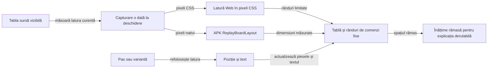
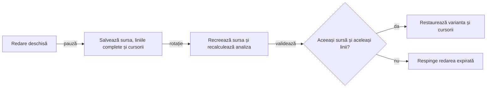

# Tabla de joc

## Pe scurt

- **Domeniu.** Motorul comun decide legalitatea mutărilor. Android și Web redau poziția prin adaptoarele lor. [Adaptorul Web și contractul comun](../../web/README.md)
- **Probe.** `BoardPanelLayoutTest` verifică geometria, `QuestHintTest` verifică indiciile, iar `MatchActionsTest` verifică comenzile partidei. `ChessWebQuestStudyTest` verifică comenzile de studiu fără Android.
- **Acces rapid.** [Probleme](#tactică-și-puncte) · [Tablă de analiză](#tablă-de-analiză) · [Partidă cu calculatorul](#partidă-cu-calculatorul).

## Tactică și puncte

- În **Tactică**, caută mutarea care câștigă material sau deschide o combinație. Când exercițiul are o continuare jucabilă, adversarul răspunde pe tablă și joci până la ultima mutare. **Explicația** îți arată linia, piesele capturate și schimbarea de material. La exercițiile care se încheie după cheie, **Studiul apărării** poate arăta ce urmează după replica aleasă de Stockfish.
- În **Probleme → Antrenament tactic** găsești 114 poziții, printre care combinații de turn, mutări intermediare și promovări pregătite prin sacrificiu. Progresul și punctele se păstrează când revii în capitol. [Catalog și verificare](quest-curation.md#antrenament-tactic-și-lot-de-verificare)
- În **Probleme → Mutarea intermediară**, caută șahul sau captura de forțare înaintea recapturii. Capitolul crește în dificultate pe trei trepte. [Catalog și punctaj](quest-curation.md#mutarea-intermediară)
- Comanda de sub tablă arată piesa cu becul, mutarea cu săgeata și explicația cu cartea. Poți atinge pictograma sau eticheta. Ținta are 48 dp, iar în timpul replicii apare **Așteaptă**.
- Prima rezolvare a fiecărei probleme acordă 10 puncte. O serie fără greșeli sau indicii adaugă câte 2 puncte la fiecare problemă, începând de la a doua, până la 20 de puncte pe problemă. Flacăra arată lungimea seriei și funcționează între capitole.
- O greșeală sau cererea unui indiciu întrerupe seria. Rezolvarea acelei probleme rămâne eligibilă pentru cele 10 puncte de bază. Revizitarea și reluarea păstrează punctele deja acordate. Problemele rezolvate înainte de această schimbare primesc creditul de bază.

- Sistemul de puncte și bonusul de la a doua rezolvare urmează modelul Puzzle Points. În Chess Lab, flacăra reprezintă problemele consecutive rezolvate fără ajutor. [Chess.com Puzzle Points](https://support.chess.com/en/articles/9681952-what-are-puzzle-points-on-chess-com)

## Tablă și indicii

- Pătratele verzi și crem încadrează piesele Staunton. Crestătura deschisă și
  silueta mai înaltă deosebesc nebunul de pion. Coordonatele stau pe margine,
  iar ultima mutare marchează plecarea și destinația.
- La intrarea în capitol, orientarea pornește cu partea care trebuie să rezolve problema jos. **Precedentă** și **Următoarea** păstrează orientarea și coordonatele. Marcajul „la mutare” urmărește culoarea activă. Folosește **Întoarce tabla** pentru a schimba orientarea.
- Etichetele și mesajele au loc rezervat. La aceeași dimensiune de fereastră și același font, tabla își păstrează poziția și dimensiunea când se schimbă problema, mutarea din istoric sau analiza. Pe ferestre scunde, tabla rămâne pătrată și se micșorează pentru a păstra locul comenzilor.
- În probleme și în **Explică**, tabla folosește toată lățimea disponibilă când încape pe înălțime. Mesajul și progresul sunt sub tablă. Dacă spațiul este scurt, zona de detalii se poate derula, iar comenzile rămân la vedere.
- Atingerea unei piese active arată numai destinațiile legale. O a doua atingere alege destinația. Promovarea cere o alegere explicită.
- Fiecare pătrat poate primi focus și anunță coordonata, piesa și destinația legală când există. Bara de stare anunță cine mută și rezultatul detectat de motor.
- O încercare greșită păstrează poziția. Dacă mutarea dă șah, aplicația arată replica adversarului și următorul răspuns, plus câștigul net de material sau finalul când linia se termină în mat ori pat. Când mai multe replici au același scor, mesajul arată câte sunt și indică o alternativă. Atinge mesajul pentru a-l citi integral. Patul direct are un mesaj propriu.
- În Mat în 2 și Mat în 3, mutarea corectă se vede imediat. Apărarea de referință urmează după 650 ms cât timp tabla e în prim-plan. În pauză se vede culoarea adversarului la mutare, iar tabla și indiciile așteaptă răspunsul. Apoi marcajul revine la jucător și ultima mutare scoate în evidență apărarea.

### Comenzile de indiciu și explicație

- **Indiciu** marchează discret cu turcoaz pătratul piesei și îi anunță numele și coordonata. **Arată mutarea** adaugă o săgeată subțire și textul „Mutare sugerată”, cu piesa necesară la promovare. Celulele anunță textual marcajele, iar săgeata urmează coordonatele la întoarcerea tablei. După apărare, indiciul pornește de la noua poziție.
- Vârful geometric al săgeții se oprește la 12% din latura pătratului înaintea centrului destinației, pe direcția mutării. Originea, dimensiunea capului și grosimea păstrează aceleași proporții pe APK și Web. Android folosește centrele măsurate ale celulelor prin [`HintArrow`](../../chess-core/src/main/java/ro/atf/chess/HintArrow.java), inclusiv când rotunjirea la pixeli întregi produce lățimi ușor diferite pentru celulele vecine.
- Cititorul de ecran anunță culoarea și piesa la **Indiciu**, apoi include destinația la **Arată mutarea**. La atingerea unui prag, confirmarea matului include și pragul. Bara de progres păstrează pragul vizibil la revenire.
- În **Mat în 1**, **Explică** deschide poziția de mat pe o tablă separată. În **Mat în 2** și **Mat în 3**, săgețile parcurg linia câte o semimutare. În timpul rezolvării, linia pornește de la poziția curentă. După rezolvare pornește de la început și arată finalul jucat, inclusiv un mat alternativ acceptat. La ultimul pas apar explicația șahului și câmpurile de fugă.
- În explicație, mutarea curentă apare prima sub tabla fixă, deasupra motivului derulabil. **Pericol**, între săgeți, conturează regele aflat în mat sau câmpul piesei capturate și anunță motivul. Pentru o captură, calculează câștigul minim de material rămas după orice replică legală. Recaptura care șterge câștigul, matul advers și patul opresc marcajul. Săgețile îl sting la fiecare schimbare de poziție. Butonul **OK** din antet revine la problemă cu progresul și punctele păstrate.

- Modelul de ajutor în două trepte pornește de la Daily Puzzle. Explicația rămâne o acțiune separată, la fel ca dezvăluirea explicită a soluției în antrenamentul Lichess. [Chess.com Daily Puzzle](https://support.chess.com/en/articles/8708990-how-does-the-daily-puzzle-work) · [Lichess Puzzle Training](https://lichess.org/training/daily)

### Redare la dimensiunea sursei

Linia calculată, Linia de mat și previzualizările AI/teorie capturează pătratul
sursei vizibile la deschidere. Navigarea schimbă piesele și textul fără să
măsoare previzualizarea ca sursă nouă. Redeschiderea măsoară sursa curentă.
`MatchViewport` selectează chenarele native compacte în ferestrele portret
înguste și în ferestrele de cel mult 480 dp înălțime, lăsând mai mult loc tablei.

Legendă · Sursă, adaptoare și rânduri fixe

- Web păstrează `--replay-board-side`; rândurile fixe împiedică textul să
  suprapună tabla sau săgețile. Rândul indiciului AI și locul continuării se
  rezervă înaintea acțiunii. Metadatele împart un rând în ferestre scunde.
  Coloanele folosesc `minmax(0, 1fr)` pentru ca bara de derulare a explicației
  să nu lărgească zona tablei și să-i deplaseze centrul între pași.
- Android transmite `board.getWidth()` prin `MatchAnalysisView` și intrarea
  redării problemei. `ReplayBoardLayout` păstrează latura măsurată, alocă
  comenzile fixe și oferă restul explicației. O fereastră rotită sau mai îngustă
  limitează pătratul la noua zonă utilă; sursa nemăsurată folosește un calcul
  limitat de fereastră. Analiza generală a partidei își păstrează propria regulă.
- Comparați pixeli CSS utili și unități logice native, inclusiv marginile
  platformei. Contractul este afișarea echivalentă și navigarea stabilă,
  fără a cere aceiași pixeli fizici pe ecrane diferite. Componentele califică
  geometria; sanity-ul nativ califică randarea APK. [Verificare](../testing/README.md#analiza-în-partida-cu-ai)

Rotația păstrează varianta aleasă și cursorul fiecărei linii. Sursa APK
recreată măsoară noua latură înainte să redeschidă aceeași continuare.
Indiciul AI simplu rămâne simplu; Back închide redarea și revine la sursă.

Legendă · Restaurare · identitatea sursei și cursorii independenți

- `ReplayCheckpoint` validează sursa, modul, semnăturile UCI ordonate, varianta și limitele cursorilor.
- `MatchAnalysisView` deține anularea calculului și restaurarea liniilor exacte.
- `ChessActivity` și `AnalysisActivity` salvează valori mici în starea instanței; niciun obiect UI nu este reținut.

## Reguli și probleme

- [`chess-rules.yaml`](../../chess-core/src/main/resources/chess-rules.yaml) declară vectorii pieselor, deplasarea pe rază sau prin salt, sensul pionului, captura, promovarea și configurația celor două rocade. Motorul aplică blocajele, alternarea culorilor, protecția regelui și expirarea dreptului en passant. Condițiile de siguranță rămân obligatorii la încărcarea profilului standard.

- [`tactical-analysis.yaml`](../../chess-core/src/main/resources/tactical-analysis.yaml) fixează orizontul la cel mult trei mutări individuale. Mesajul din joc folosește două, începând cu replica adversarului. Fiecare parte alege cea mai bună continuare pentru ea. Matul primează, patul valorează zero, iar restul pozițiilor se compară după materialul de la capătul liniei. Câștigul afișat este diferența de material față de poziția de după încercarea jucătorului. Scorurile egale la acest orizont rămân în același grup, iar ordinea UCI alege linia afișată. Repetarea, regula mutărilor fără captură sau pion și evaluarea pozițională țin de o analiză cu istoric și orizont mai lung.

- [`quests.yaml`](../../chess-core/src/main/resources/quests.yaml) păstrează poziția FEN, soluția UCI și tema fiecărei probleme. Setul are 500 de poziții, câte 250 cu fiecare culoare la mutare. Catalogul include compoziții pentru mat prin rocadă, en passant, promovare la cal și apărare din șah.

| ID | Indiciu | Soluție |
|---|---|---|
| `mate-101` | Nebunul de pe `h6` | `Nd2#` oprește șahul turnului negru și deschide coloana h pentru dama albă. |
| `mate-102` | Pionul de pe `h3` | `hxg4#` capturează calul care dă șah și eliberează coloana h pentru turnul alb. |

- [`mate-in-two.yaml`](../../chess-core/src/main/resources/mate-in-two.yaml) are 300 de poziții cu o singură mutare inițială care forțează matul. După acea mutare, aplicația joacă apărarea de referință și acceptă orice mat legal din poziția rezultată. Indiciile urmează mutarea curentă, iar explicația arată linia completă. [Selecție și proveniență](quest-curation.md#mat-în-două-mutări)

- [`mate-in-three.yaml`](../../chess-core/src/main/resources/mate-in-three.yaml) conține 200 de poziții de mat exact în trei, cu o singură primă mutare câștigătoare. Jocul aplică cele două apărări de referință, afișează câte mutări au mai rămas după prima apărare și acceptă orice mat legal pe ultima mutare. [Selecție și proveniență](quest-curation.md#mat-în-trei-mutări)

- [`tactics.yaml`](../../chess-core/src/main/resources/tactics.yaml) adaugă 100 de poziții cu o singură mutare care câștigă material la orizontul capitolului. Selecția include furculițe, legări, atacuri descoperite și devieri.

## Tablă de analiză

- Din meniul principal pornești de la poziția inițială. Dintr-o partidă, lupa de lângă istoric deschide exact poziția afișată și păstrează mutările partidei disponibile pentru navigare.
- Joci manual pentru alb și negru. Evaluarea se actualizează local după fiecare poziție, iar becul arată o continuare. Săgețile și mutările din bandă selectează poziții. O mutare diferită înlocuiește continuarea din tablă, iar **Resetează linia** readuce poziția și continuarea de la intrare.
- Cât timp poziția are continuări de teorie, becul alege între cel mult trei trasee complete. Sub tablă vezi **Teorie**, numărul traseului și numele deschiderii. Atinge eticheta pentru redarea pe tot ecranul. Săgețile parcurg mutările ambelor culori, tabla își păstrează poziția, iar explicația fiecărui pas se poate derula separat. Două trasee pot începe prin aceeași mutare. Lecțiile YAML au prioritate, iar indexul ECO oferă continuări când lecțiile nu acoperă poziția. La o poziție fără continuări documentate, becul revine la analiza motorului. O transpoziție sau revenirea în istoric poate readuce teoria.
- După ce afișezi o variantă, atinge direct destinația din săgeată pentru a juca prima mutare, inclusiv promovarea indicată. Dacă selectezi o piesă după afișarea indiciului, alegi mutarea în mod obișnuit. Pe o poziție istorică jucabilă, mutarea se aplică liniei de studiu.
- După abandon sau remiză prin acord, ultima poziție rămâne jucabilă în analiză. Matul și finalurile automate rămân finale. Poți explora de la o poziție anterioară.
- În **Opțiunile tablei de analiză**, bifa **Analiză AI** controlează bara, becul și **Analizează toate mutările**. Raportul parcurge întreaga linie curentă, chiar dacă săgețile te-au dus la o poziție anterioară. Compară albul și negrul prin grafic, categorii și precizie. Din detaliul oricărei mutări poți reveni pe tablă sau porni din poziția de dinaintea mutării.
- Când linia păstrează mutările unei partide încheiate, aceeași comandă deschide **Analiza partidei** cu jucătorul, AI-ul, graficul, toate mutările și estimările Elo disponibile. Dacă partida are loc în arhivă, raportul se salvează acolo. O ramură editată sau o linie jucată manual rămâne un studiu pe culori, cu precizie și categorii.
- **Continuă ca partidă salvată** păstrează istoricul până la poziția selectată și folosește un loc liber dintre cele zece. Bifează **Lasă AI-ul să mute** pentru replici automate. Debifează pentru a juca ambele culori. Partida din care ai intrat în studiu își păstrează salvarea. Dacă toate locurile sunt ocupate, tabla păstrează linia deschisă. O continuare pornită cu un prefix din studiu păstrează graficul și precizia la final, cu Elo indisponibil pentru acea linie.

- Navigarea și mutările manuale pentru ambele culori urmează fluxul de analiză individuală. [Tabla de analiză Chess.com](https://support.chess.com/en/articles/8583825-how-do-i-use-the-analysis-board)

## Partidă cu calculatorul

- Meniul principal grupează **Partidă nouă**, **Partide salvate** și **Partide încheiate** în secțiunea **Partide**. Problemele, deschiderile și tabla de analiză sunt în **Studiu**, iar numele jucătorului este în **Profil**. Ambele liste de partide se deschid ca ecrane dedicate, în stilul meniului **Probleme**. **Înapoi** rămâne vizibil când derulezi și revine la ecranul de unde ai venit.

### Partide salvate și încheiate

- **Partide încheiate** păstrează ultimele zece rezultate, în ordinea încheierii, de la cel mai recent. Poți redeschide tabla și istoricul fiecărei partide. Dacă ai lăsat analiza să se termine, lista o marchează ca salvată, iar **📊 Analiza partidei** o deschide direct. Continuarea pornită din arhivă folosește un loc liber și păstrează rezultatul original. La al unsprezecelea rezultat, cel mai vechi rezultat și analiza lui ies din arhivă.

- **Partide salvate** arată doar partidele în desfășurare, până la zece, de la cea mai recent începută. La încheiere, partida trece în **Partide încheiate** în aceeași salvare. **Partidă nouă** folosește primul loc gol, apoi poate reutiliza locul unei partide arhivate. Când toate locurile sunt ocupate de partide active, configurarea anunță înlocuirea celei mai vechi salvări. Reluarea unei partide îi păstrează locul în ordine. Pentru salvările din edițiile anterioare, ordinea inițială urmează numărul locului.

- Rândul începe cu numărul partidei și numele adversarului în **Partide salvate** și cu numele adversarului în **Partide încheiate**. Sub titlu apar numărul de mutări înregistrate și starea sau rezultatul. Fiecare mutare a albului sau a negrului se numără o dată.

- Eticheta discretă de la baza rândului arată ziua și ora locală. În **Partide salvate** apare momentul începerii, iar în **Partide încheiate** momentul terminării. Pentru partidele vechi a căror dată lipsește, rândul afișează titlul și mutările.

### Comenzi și preferințe

- Numele și configurarea unei partide noi sunt disponibile din meniul principal.
  Bara partidei urmează același inventar de acțiuni pe Android și Web.

- Bifa **Lasă AI-ul să mute** stă în antet, pe același rând cu meniul. Debifeaz-o
  pentru a juca mutările legale ale ambelor culori. Opțiunea se salvează separat
  pe fiecare partidă, iar bifarea în tura AI-ului pornește replica. În istoricul
  unei partide active, bifa rămâne vizibilă și dezactivată. După rezultat, antetul
  afișează doar meniul. Când schimbi partida, o
  replică aflată în calcul se anulează și poate fi recalculată la revenire. Dacă
  ai jucat pentru AI, analiza afișează precizia și categoriile pe culori, iar
  estimările Elo sunt indisponibile pentru acea partidă.

- Butonul cu trei linii deschide **Opțiunile partidei**. De aici întorci tabla,
  revii în **Meniu principal**, deschizi **Partide salvate** și trimiți poziția
  curentă în **Tablă de analiză**. În timpul jocului, poți oferi remiză la mutarea
  ta. AI-ul refuză când are avantaj material și acceptă în celelalte poziții.
  **Renunță la partidă** cere confirmare și salvează victoria AI-ului. Revenirea
  în meniul principal păstrează partida pentru reluare. În istoric sunt disponibile
  comenzile de navigare, orientare și studiu.

- Din meniul principal, **Probleme** grupează capitolele și progresul. În **Profil**, atinge numele pentru a-l edita sau reseta. Numele are cel mult 10 caractere și apare la locul jucătorului, inclusiv în partida reluată.

- Tot acolo, **Setări** deschide selectorul **Română / English**. Alege limba
  și apasă **Salvează**. Limba se aplică imediat și se păstrează la redeschidere.
  Până la prima alegere, aplicația folosește limba dispozitivului. Același
  profil, aceleași partide și același progres sunt disponibile în ambele limbi.

### Pornire, reluare și navigare

- În **Partidă nouă**, alege culoarea Alb, Negru sau Aleatoriu și nivelul AI. Jocul rezolvă alegerea aleatorie o singură dată și așază culoarea jucătorului jos. Când joci cu negrul, calculatorul deschide cu albele. Alex joacă la Basic, Mira la Advanced și Atlas la Hard. Basic caută două semimutări în pozițiile obișnuite și trei în finalurile elementare de turn sau damă contra regelui; Advanced caută patru. Hard obișnuit încearcă șase, pornind de la 100.000 de noduri suplimentare și cu o rezervă adaptivă până la 200.000. Căile explicite din repertoriu își păstrează alocația configurată. Schimbarea liderului la adâncimea finală păstrează rezultatul complet anterior, cu excepția unui rezultat nou care dovedește matul câștigător. În finalurile de turnuri Hard poate extinde cu încă o semimutare, până la șapte, folosind istoricul repetițiilor și aceeași alocație activă. La egalitate, motorul preferă pozițiile vizitate mai rar și mutările care dezvoltă piesele sau ocupă centrul. Replica apare după cel puțin 650 ms. [Politica și validarea Stockfish](ai-quality.md)

- Jocul salvează istoricul înainte de a afișa fiecare mutare. Alegerea unei partide din **Partide salvate** și redeschiderea directă refac poziția, culoarea, nivelul, analiza și orientarea. Dacă motorul are mutarea, pauza reîncepe și urmează o singură replică. Salvările anterioare revin cu Alb și Basic.

- Într-o partidă cu AI, pe mobil, tabla are latura maximă care încape după
  barele sistemului, rândurile jucătorilor și comenzi. Când analiza este
  activă, bara ocupă o fâșie în stânga, pe toată înălțimea tablei. Mutările
  din istoric schimbă poziția afișată fără să deplaseze tabla. Becul rămâne
  lângă săgeți, cu o zonă de atingere de cel puțin 48 dp.
  [Proba compactă RO/EN](../testing/README.md#analiza-în-partida-cu-ai)

- Sub tabla partidei, săgețile parcurg fiecare mutare. Între ele apare doar mutarea selectată; **Start** numește poziția inițială. Ambra marchează prima mutare, iar turcoazul ultima, cu descrieri accesibile corespunzătoare. O mutare unică are ambele indicii. Pe Android, săgeata cu opritor revine la ultima mutare. Controalele păstrează ținte de 48 dp, iar pozițiile anterioare sunt blocate. O replică adăugată în timpul consultării actualizează limita fără a înlocui poziția selectată. Tabla de analiză păstrează separat banda istoricului complet. [Navigarea între mutări pe Chess.com](https://support.chess.com/en/articles/10328363-how-do-i-use-game-review-on-the-app)

- Alege o poziție din istoric și apasă **Continuă de aici** sub tablă. Confirmarea păstrează poziția și mutările care duc la ea. Mutările de după poziția aleasă sunt eliminate din partida salvată. Bifa **Lasă AI-ul să mute** pornește replica atunci când e rândul calculatorului. Poți continua și dintr-o partidă terminată. Din arhivă, continuarea folosește un loc liber.

### Analiza partidei și indiciile

- **Analiza partidei** ocupă fereastra aplicației din timpul calculului, cu butonul **Închide** în antet. Derulează graficul, precizia, estimările Elo, tabelul și lista mutărilor în același ecran. În tabel, coloana **Jucător** este mereu prima dintre cele numerice, inclusiv când joci cu negrul. Fiecare categorie are un rând, cu zero când lipsește. [Reperul Game Review](https://support.chess.com/en/articles/10328363-how-do-i-use-game-review-on-the-app)

[Schemele și formulele analizei](game-review.md)

- La final, deschide **Analiza partidei** din **Opțiunile partidei** sau de sub
  rezultat. Cu **Analiză AI** activată, raportul este disponibil și după prima
  mutare a unei partide în curs; replica automată așteaptă până îl închizi.

- Alegerea unei mutări din listă sau din grafic sincronizează tabla, scorul,
  notația și categoria. Comenzile permit navigarea și saltul la următorul moment-cheie.
- **De ce?** explică diferența dintre mutarea aleasă și recomandare. Poți parcurge
  ambele linii cu săgețile. Becul indică următoarea mutare din varianta recomandată.
- O analiză arhivată se redeschide la ultima mutare, linie și pas consultat.
  **Vezi pe tablă** revine la poziția selectată în partidă.
- **Reîncearcă mutarea** propune reluarea din poziția anterioară. După confirmare,
  partida din arhivă rămâne disponibilă și ramura folosește un loc separat.
- Reperul AI și estimarea Elo apar în analiza unei partide încheiate, când
  sunt aplicabile. [Metoda de analiză și estimare](game-review.md)

- Bifează **Analiză AI** înainte de pornire. Bara verticală reflectă evaluarea poziției afișate, inclusiv în istoric. Segmentul mai lung indică partea în avantaj, iar la întoarcerea tablei segmentele își schimbă capetele. Textul arată scorul pozițional în unități de pion. `+1,25 · Alb` favorizează albul, iar `−1,25 · Negru` favorizează negrul. Bara se umple la opt unități sau la mat și se împarte egal la remiză. [Convenția de evaluare Chess.com](https://support.chess.com/en/articles/8379354-computer-evaluation-numbers-on-chess-com)

- Apasă becul din bara de sub tablă pentru linia recomandată curentă și săgeata primei mutări. Când controlezi culoarea la mutare, atinge destinația indicată ca să joci prima mutare. În istoric poți consulta varianta și alege **Continuă de aici** pentru a juca din poziția afișată. În tura AI-ului poți aștepta replica sau debifa **Lasă AI-ul să mute** pentru a juca acea mutare.

- Indiciul folosește nucleul de căutare Hard, independent de nivelul adversarului.
  Căutarea inițială, schimburile tactice și comparația împart plafonul de 200.000
  de noduri. Până la 150.000 dintre ele compară alternativele la adâncime comună.
  Becul parcurge cel mult trei variante aflate la maximum 0,25 pioni sub lider.
  Căutarea evaluează capturile și recapturile înaintea ordonării variantelor.
  La mat demonstrat, variantele au același rezultat și aceeași distanță.
  [Evaluarea AI](ai-quality.md)

- După bec, **Vezi linia** deschide tabla la poziția consultată. Prima săgeată
  înainte joacă recomandarea și a doua arată replica. Rejucarea urmează exact
  continuarea evaluată, inclusiv schimburile verificate, fără o mutare adăugată
  după ordonare. Sub tablă apar scorul inițial,
  scorul final și diferența, din perspectiva culorii care muta la început.
  Avantajul poate veni din evaluarea poziției, iar matul și patul au rezultat
  propriu. Săgețile parcurg toate semimutările disponibile.

- Indiciile calculate și teoria deschiderilor folosesc aceeași suprafață de
  redare pe tot ecranul Android. Tabla și săgețile își păstrează dimensiunile
  când detaliile se derulează dedesubt. Fiecare linie își reține pasul când schimbi varianta.

- Prima variantă din bec și linia recomandată coincid. Atingerea destinației
  joacă exact mutarea marcată. **Înapoi la poziție** restaurează cursorul și
  indiciul, inclusiv pe tabla manuală. Schimbarea poziției și terminarea partidei
  ascund indiciul. Opțiunea **Analiză AI** se păstrează la reluare.

### Material și rezultate

- Sub fiecare nume apar piesele capturate, cu un număr lângă simbol când sunt mai multe de același fel. Jucătorul cu avantaj material vede `+N` în același rând. Capturile și avantajul urmează semimutarea afișată, inclusiv în istoric și după reluare. [Referința de afișare Chess.com](https://support.chess.com/en/articles/8708638-how-can-i-see-the-captured-pieces-and-material-count)

- Motorul aplică rocada, en passant și alegerea la promovare. Partida se oprește la mat, pat, configurațiile uzuale de material insuficient, a cincea apariție a poziției sau 75 de mutări de fiecare parte fără captură ori mutare de pion. Remizele la cerere fac parte din regulile de competiție. [Regulile FIDE](https://handbook.fide.com/chapter/e012023)

## Dificultate și progres

- Mat în 1 începe cu matul nebunului și continuă în ordinea strict crescătoare a scorului intern. Profilul YAML stabilește ponderile pentru numărul de mutări legale, șahurile înșelătoare, apărările unice, mutările speciale și matul pornit din șah. Ordinea derivată se încarcă din `quest-order.yaml`. Mat în 2 și Mat în 3 urmează ratingurile din cataloage, iar Tactică urmează câmpul `difficulty`. [Profil YAML](../../chess-core/src/main/resources/quest-difficulty.yaml) · [Cum se întrețin cataloagele](quest-curation.md#configurarea-capitolelor)

- Aplicația salvează ID-ul problemei curente, etapa atinsă și ID-urile rezolvate. Pentru problemele de mat, salvează și mutarea finală efectivă, astfel încât tabla și explicația să redea matul jucat. Rezolvările mai vechi fără mutare finală salvată afișează linia de referință. Reordonarea schimbă numărul afișat, iar identitatea salvată stabilește ce problemă se redeschide. Dacă problema curentă a fost retrasă, aplicația deschide prima problemă nerezolvată din același capitol. Rezolvările retrase rămân în salvare ca istoric, în afara totalului activ. ID-urile retrase rămân rezervate. [Registrul de ID-uri](../../chess-core/src/main/resources/quest-retired.yaml)

- La prima pornire se deschide meniul. După alegere, redeschiderea revine în același capitol și reia poziția unei probleme în curs. Dacă răspunsul era în așteptare, pauza începe din nou în prim-plan și apărarea se aplică o singură dată. Butonul **Meniu** revine la selecție, păstrând progresul fiecărui capitol. **Următoarea** se activează după rezolvarea problemei și rămâne în același capitol.

- Bara arată progresul în capitolul deschis. Pragurile 5, 15, 30, 50, 75 și finalul capitolului se recalculează din ID-urile rezolvate. La atingerea unui prag, ecranul confirmă realizarea și afișează următoarea țintă. Bara și textul pornesc de la același total după reluare. Ideea țintelor vizibile vine din Puzzle Journey. [Chess.com Puzzle Points](https://support.chess.com/en/articles/9681952-what-are-puzzle-points-on-chess-com)

- [Regulile de șah și poziția inițială](https://handbook.fide.com/chapter/e012023)
