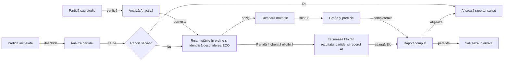
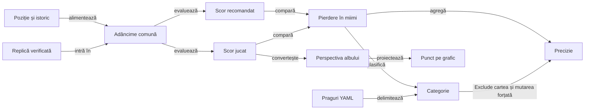
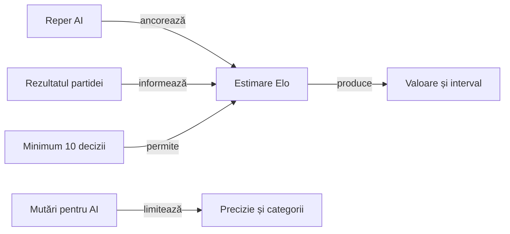
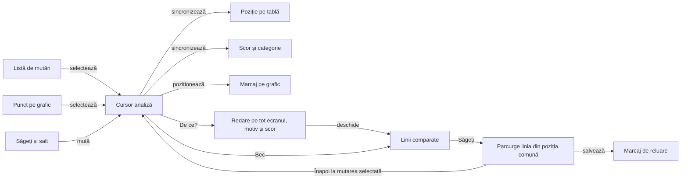

# Cum se calculează analiza partidei

## Pe scurt

- **Domeniu.** `GameReview` calculează categoriile, precizia și variantele jucate și recomandate pentru redare. Elo cere o partidă încheiată eligibilă. [Calculul](../../chess-core/src/main/java/ro/atf/chess/GameReview.java)
- **Probe.** `GameReviewTest` verifică formulele, `GameReviewTimelineTest` verifică legalitatea redării, iar `GameReviewGraphParityTest` verifică navigarea între interfețe.

- **Analiza partidei** este disponibilă după un rezultat final, inclusiv după remiză sau renunțare. Cu **Analiză AI** bifată, meniul poate porni și analiza mutărilor înregistrate până atunci. **Analizează toate mutările** din tabla de studiu aplică aceeași căutare liniei explorate. În studiul manual, tabelul și precizia se afișează pe alb și negru. Raportul provizoriu și studiul folosesc rezultatele poziționale, iar Elo se calculează pentru o partidă încheiată eligibilă.

## De la partidă la raport



<details>
<summary>Legendă — când se calculează și se salvează raportul</summary>

- Partida în curs și studiul cer analiza activă și cel puțin o mutare.
- Raportul calculează categoriile și precizia. Elo se adaugă pentru partida
  încheiată eligibilă, iar salvarea cere o intrare prezentă în arhivă.

</details>

- Indexul ECO identifică ultima poziție denumită, inclusiv dacă poziția a fost atinsă prin transpoziție. Separat, marchează prefixul de mutări care urmează efectiv o linie de carte. O mutare din acel prefix primește categoria **De carte** doar dacă pierde sub 100‰ față de recomandare. [Indexul ECO](../../chess-core/src/main/java/ro/atf/chess/OpeningIndex.java)

## Evaluarea unei semimutări

- O semimutare este mutarea unei singure culori. Înaintea fiecăreia, motorul recuperează poziția și istoricul. La rădăcina căutării identifică mutările care duc imediat la remiză automată prin material, repetiție sau numărul de semimutări fără pion ori captură. Analiza compară cea mai bună variantă găsită și mutarea jucată la aceeași adâncime finalizată. Căutarea pornește de la trei semimutări și încearcă să ajungă la șase, cu extensie tactică și un buget de 85.000 de noduri suplimentare pe poziție. Dacă o iterație depășește bugetul, rămâne rezultatul iterației precedente. [Căutarea](../../chess-core/src/main/java/ro/atf/chess/TacticalAnalysis.java) · [Configurația](../../chess-core/src/main/resources/game-review.yaml)



<details>
<summary>Legendă — traseul scorurilor</summary>

- Comparația folosește adâncimea încheiată pentru ambele mutări. Graficul
  exprimă fiecare scor jucat din perspectiva albului.

</details>

- Scorul intern se raportează la culoarea care mută. Motorul evaluează pozițiile obișnuite în centipioni, iar maturile demonstrabile primesc scoruri extreme. Analiza transformă scorul pe scara 0–1.000, apoi compară cele două valori.

```text
puncte(cp) = rotunjire(1000 / (1 + exp(-cp / 220)))
pierdere = max(0, puncte(recomandare) - puncte(mutare jucată))
```

- De exemplu, dacă recomandarea are +220 cp și mutarea jucată 0 cp, valorile sunt 731‰ și 500‰. Pierderea este **231‰**. Pe grafic, 500‰ înseamnă echilibru. Pentru o mutare a negrului, valoarea desenată este `1000 − puncte(mutare jucată)`, astfel încât partea de sus favorizează mereu albul. Primul punct pornește de la evaluarea recomandării din poziția inițială. [Calcul și grafic](../../chess-core/src/main/java/ro/atf/chess/GameReview.java) · [Afișarea Android](../../android/app/src/main/java/ro/atf/chess/android/GameReviewDialog.java)

- În pozițiile exacte din repertoriul verificat, raportul recomandă replica de repertoriu și evaluează ambele variante la aceeași adâncime încheiată. O linie terminală demonstrată sau o remiză automată la rădăcină păstrează prioritatea. Dacă evaluarea locală a mutării jucate depășește scorul recomandării, pierderea rămâne zero. [Repertoriul](../../chess-core/src/main/resources/ai-repertoire.yaml)

## Categorii și precizie

- Motorul verifică regulile în ordinea de mai jos. Prima regulă aplicabilă stabilește categoria. Pragurile din tabel sunt valorile implicite ale secțiunii `classification` din [game-review.yaml](../../chess-core/src/main/resources/game-review.yaml). Testele de guvernanță verifică valorile, unitățile întregi și ordinea pragurilor. Analizele deja salvate păstrează rezultatul calculat la momentul respectiv. Toate mutările intră în tabel, iar coloana jucătorului rămâne prima dintre cele numerice chiar dacă joacă cu negrul.

| Ordine | Categorie | Condiție |
|---|---|---|
| 1 | De carte | În prefixul ECO, cu pierdere sub 100‰. |
| 2 | Forțată | Există o singură mutare legală. |
| 3 | Strălucită | Scor cel puțin egal cu al recomandării, adâncime de minimum 4, scor jucat de cel puțin 550‰ și sacrificiu acceptat de minimum 200 cp în replica găsită. Mai cere un avantaj de cel puțin 100‰ față de alternativa estimată sau un singur mat demonstrat în căutare. |
| 4 | Excelentă tactic | Scor cel puțin egal cu al recomandării, adâncime de minimum 4, avantaj de cel puțin 100‰ față de alternativă și trecerea pragului evaluat de motor. Recomandarea ajunge la minimum 750‰ cu alternativa sub 700‰ sau la minimum 450‰ cu alternativa sub 400‰. |
| 5 | Cea mai bună | Scorul intern al mutării atinge cel puțin scorul recomandării. |
| 6 | Ocazie ratată | Adversarul tocmai a pierdut cel puțin 100‰, recomandarea ajunge la minimum 750‰, iar mutarea jucată la maximum 550‰. |
| 7–11 | Greșeală gravă, greșeală, imprecizie, bună, excelentă | Pragurile sunt ≥200‰, ≥100‰, ≥50‰, ≥20‰, respectiv sub 20‰. |

- Precizia se calculează separat pentru fiecare culoare, din pierderile mutărilor cu alegere. Mutările de carte și cele forțate sunt excluse.

```text
precizie = rotunjire(100 - suma pierderilor / (10 × numărul de mutări cu alegere))
```

- Cu două mutări eligibile care pierd 231‰ și 50‰, precizia este **86%** după rotunjire. Fără mutări eligibile, câmpul rămâne necompletat. [Clasificarea și agregarea](../../chess-core/src/main/java/ro/atf/chess/GameReview.java)

## Cum se estimează Elo



<details>
<summary>Legendă — eligibilitatea estimării Elo</summary>

- Reperul și rezultatul produc estimarea dacă există suficiente mutări cu
  alegere. Intervenția jucătorului pentru AI limitează raportul la datele
  poziționale.

</details>

- Elo estimat folosește rezultatul și reperul profilului AI. Pentru jucător, `s` este 1 la victorie, 0,5 la remiză și 0 la înfrângere. Formula se aplică după minimum zece mutări cu alegere.

```text
p = (1 + s) / 3
diferență Elo = rotunjire(400 × log10(p / (1 - p)))
estimare = Elo de referință + diferență Elo
```

- Rezultatul unic actualizează o distribuție uniformă a scorului așteptat la `Beta(1 + s, 2 − s)`. Afișajul adaugă diferențele Elo din cuantilele 5% și 95% la capetele intervalului reperului AI. De exemplu, o înfrângere contra **Advanced**, cu reper 1461 și suficiente decizii, dă **≈1341 (549–1900)**. Intervalul arată cât de puțină informație oferă o singură partidă. Reperul AI provine din protocolul local de calibrare cu Stockfish. [Calibrarea externă](ai-quality.md#rezultatele-ancorei-externe) · [Configurația](../../chess-core/src/main/resources/game-review.yaml)

## Salvare și verificare

- Analiza terminată se păstrează lângă partida din arhivă. Cache-ul are versiune și amprenta SHA-256 a salvării exacte, inclusiv rezultatul și configurația. O analiză absentă, trunchiată sau incompatibilă se recalculează la redeschidere.
- Raportul din arhivă include scorurile și liniile calculate pentru fiecare mutare. Marcajul păstrează semimutarea, linia, pasul și starea ferestrei **De ce?** după redeschidere sau restart. Închiderea explicită lasă mutarea selectată în istoric. ID-ul arhivei și amprenta salvării leagă marcajul de partida exactă. Prima deschidere pornește la final. O linie sau un pas indisponibil readuce tabla la poziția jucată.
- Închiderea ferestrei în timpul calculului oprește căutarea. Arhiva reține ultimele zece rezultate și elimină raportul și marcajul odată cu intrarea veche. Continuarea din arhivă creează o partidă separată.
- `GameReviewTest` verifică evaluarea, clasificarea, estimarea Elo și reconcilierea tabelului. `GameReviewGovernanceTest` verifică pragurile, reperele și catalogul ECO. `MatchArchiveTest` verifică refacerea raportului complet și respingerea cache-urilor incompatibile. [Strategia de testare](../testing/README.md#partidă-și-istoric)

## Navigarea în review și variantele recomandate

- Review-ul măsoară spațiul util al ferestrei după antet și zonele de sistem. În portret, tabla este cel mai mare pătrat care lasă loc barei de comenzi și începutului raportului derulabil. Într-o fereastră lată, raportul trece lateral când rămâne lizibil și tabla poate crește. Cursorul, indiciul și numele deschiderii se pot schimba fără să deplaseze tabla.

- Săgețile schimbă câte o semimutare, iar comanda **Moment-cheie următor** sare la următoarea poziție marcată. Lista și graficul permit selecția directă. Tabla, notația, categoria, scorurile și markerul graficului urmăresc același cursor. Săgețile se dezactivează la capete. Bara are ținte de 48 dp și etichete accesibile în română și engleză. În ferestre foarte înguste, bara derulează orizontal. Detaliile de scor, graficul, precizia, Elo, comparația și lista mutărilor se derulează împreună.

- Punctele desenate și atingerea folosesc aceeași proiecție orizontală, inclusiv marginile graficului. Atingerea alege semimutarea cea mai apropiată și sincronizează markerul, tabla și evidențierea mutării din listă. Poziția inițială nu are rând în listă. Atingerea în margini selectează poziția inițială sau finală. Comanda de accesibilitate pentru un rând derulează direct până la mutarea cerută, inclusiv într-o partidă lungă.

- Numele deschiderii identificate apare la intrare. Prima navigare sau activarea variantei îl retrage din raport. **Detalii despre deschidere** din meniul de acțiuni afișează la cerere numele și codul ECO.



<details>
<summary>Legendă — cursorul și liniile de analiză</summary>

- Lista, graficul și săgețile trimit selecția către același cursor.
- Liniile păstrează mutarea de origine și pasul ales pentru redeschidere.

</details>

- Becul deschide linia recomandată direct în review. La o mutare care pierde scor, **De ce?** deschide aceeași fereastră pe tot ecranul ca Teoria deschiderilor. Tabla și săgețile rămân fixe, iar explicația se derulează separat. **După mutare** și **Recomandată** pornesc din poziția anterioară mutării selectate. Prima mutare din **După mutare** este cea din partidă, iar continuarea conține replicile calculate. **Înapoi** revine la mutarea selectată, cu graficul și lista în locul în care erau. [Teoria pe tabla de analiză](openings.md#indicii-de-teorie-pe-tabla-de-analiză)

- Pentru o mutare cu pierdere de scor, explicația folosește liniile validate cu regulile și istoricul poziției. În exemplul `g4`, linia jucată arată `…Qh4#`. La mat prin promovare, explicația numește piesa ajunsă pe ultima linie. La material, compară ramurile la același număr de pași și numește captura care produce cea mai mare pierdere ce persistă până la finalul comparației. Deficitul net descrie întreaga comparație. Când ramura recomandată dovedește un câștig material ratat la același orizont, explicația numește captura și valoarea care rămâne după apărare. Când dovada tactică lipsește, explicația arată evaluarea mutării jucate, evaluarea recomandării și adâncimea comună, din perspectiva culorii care mută. O linie ilegală din cache rămâne indisponibilă. [Proba mutării](../../atf-tests/src/test/java/ro/atf/chess/GameReviewTimelineTest.java)

- În meniul de acțiuni, **Vezi pe tablă** închide review-ul și mută cursorul activ la semimutarea aleasă. **Reîncearcă mutarea** cere confirmarea continuării din poziția anterioară pentru mutările jucătorului sau pentru ambele culori în studiu. Anularea sau lipsa unui loc liber păstrează analiza la linia și pasul curent. Continuarea confirmată din arhivă deschide o partidă nouă din prefixul original.

- `GameReviewTimeline` validează fiecare mutare și culoare față de sursă. `GameReviewLayout` alege geometria din dimensiunile măsurate. Verificările componentelor și parcursul Android urmăresc sincronizarea, navigarea variantei și păstrarea partidei. [Sanity și Extent](../testing/README.md#partidă-și-istoric)

## Limitările măsurate ale analizei

Studiul pereche din 18 noiembrie rulează efectiv `GameReview.analyzeLine` pe trei partide de deschidere limitate. Păstrează toate cele 60 de mutări, PV-urile jucate și recomandate legale și absența Elo pentru studiu. Rădăcinile jucate au dovezi independente Stockfish H17/H19. Nouă neconcordanțe persistă la ambele orizonturi: trei etichete native pozitive însoțesc o pierdere de cel puțin 150‰, iar șase etichete native severe însoțesc sub 10‰ pierdere. Aceasta nu evaluează independent fiecare alternativă a analizei.

`6.e6` din Caro–Kann este BEST cu precizia albului 100, deși rădăcina jucată pierde 533‰ / 581,5‰. `5.Nc3` din Siciliană este BLUNDER cu 0‰ / 0‰ pierdere. Sunt martori de regresie cu istoric complet pentru comparație și clasificare, nu eșecuri de navigare sau arhivare. Punctele logistice locale și WDL ale oracolului sunt modele distincte; redarea legală nu certifică eticheta. [Dovezi pereche și interpretare](../testing/hard-hint-study.md) · [Criterii deschise de corecție](../feedback/README.md)

## Analiza după corecția indiciului

Corecția țintită a indiciului Caro–Kann păstrează rezultatul efectiv `GameReview.analyzeLine` identic după proiecția JSON pe toate cele șaizeci de mutări rejucate. Cele nouă neconcordanțe anterioare H17/H19 de clasificare rămân deschise. `6.e6` este încă etichetată BEST, iar `5.Nc3` din Siciliană BLUNDER. Istoricul păstrat și indiciul live corectat nu trebuie prezentate drept corectare a comparației din analiză. Nu se emite Elo pentru studiu. [Constatări legate de sursă](ai-quality.md#indiciul-carokann-și-verificarea-recapturii-după-pionul-cu-șah)
