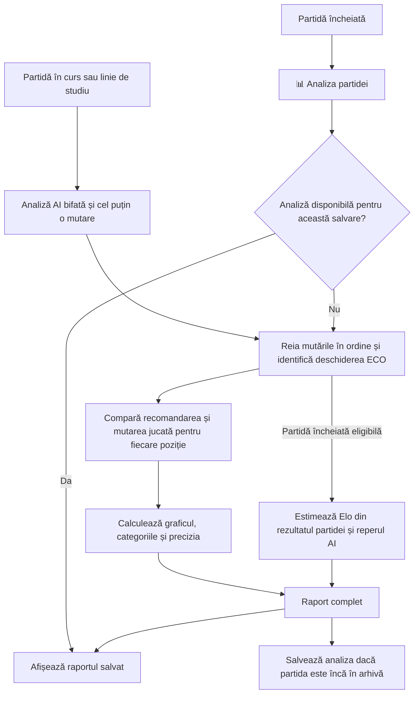
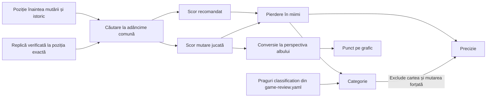
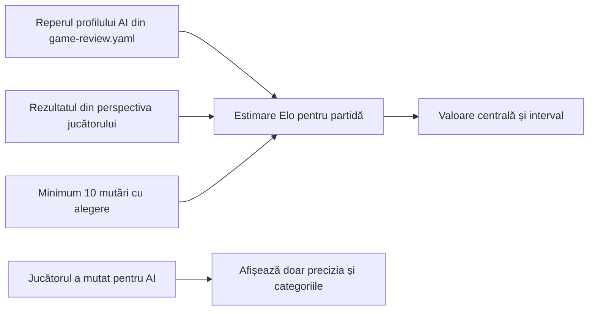
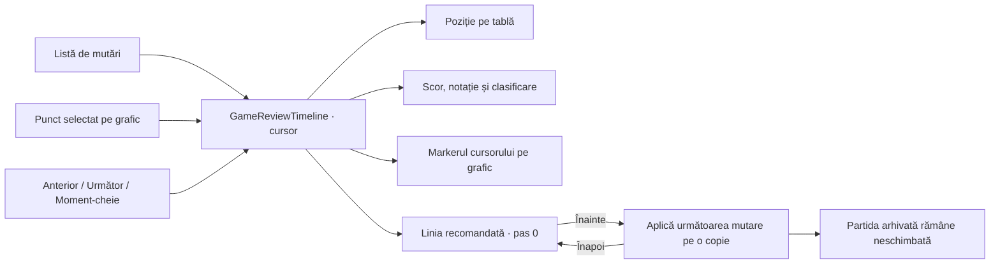

# Cum se calculează analiza partidei

**📊 Analiza partidei** este disponibilă după un rezultat final, inclusiv după remiză sau renunțare. Cu **Analiză AI** bifată, meniul poate porni și analiza mutărilor înregistrate până atunci. **Analizează toate mutările** din tabla de studiu aplică aceeași căutare liniei explorate. În studiul manual, tabelul și precizia se afișează pe alb și negru. Raportul provizoriu și studiul folosesc rezultatele poziționale, iar Elo se calculează pentru o partidă încheiată eligibilă.

## De la partidă la raport



Indexul ECO identifică ultima poziție denumită, inclusiv dacă poziția a fost atinsă prin transpoziție. Separat, marchează prefixul de mutări care urmează efectiv o linie de carte. O mutare din acel prefix primește categoria **De carte** doar dacă pierde sub 100‰ față de recomandare. [Indexul ECO](../../chess-core/src/main/java/ro/atf/chess/OpeningIndex.java)

## Evaluarea unei semimutări

O semimutare este mutarea unei singure culori. Înaintea fiecăreia, motorul recuperează poziția și istoricul. La rădăcina căutării identifică mutările care duc imediat la remiză automată prin material, repetiție sau numărul de semimutări fără pion ori captură. Analiza compară cea mai bună variantă găsită și mutarea jucată la aceeași adâncime finalizată. Căutarea pornește de la trei semimutări și încearcă să ajungă la șase, cu extensie tactică și un buget de 85.000 de noduri suplimentare pe poziție. Dacă o iterație depășește bugetul, rămâne rezultatul iterației precedente. [Căutarea](../../chess-core/src/main/java/ro/atf/chess/TacticalAnalysis.java) · [Configurația](../../chess-core/src/main/resources/game-review.yaml)



Scorul intern se raportează la culoarea care mută. Motorul evaluează pozițiile obișnuite în centipioni, iar maturile demonstrabile primesc scoruri extreme. Analiza transformă scorul pe scara 0–1.000, apoi compară cele două valori.

```text
puncte(cp) = rotunjire(1000 / (1 + exp(-cp / 220)))
pierdere = max(0, puncte(recomandare) - puncte(mutare jucată))
```

De exemplu, dacă recomandarea are +220 cp și mutarea jucată 0 cp, valorile sunt 731‰ și 500‰. Pierderea este **231‰**. Pe grafic, 500‰ înseamnă echilibru. Pentru o mutare a negrului, valoarea desenată este `1000 − puncte(mutare jucată)`, astfel încât partea de sus favorizează mereu albul. Primul punct pornește de la evaluarea recomandării din poziția inițială. [Calcul și grafic](../../chess-core/src/main/java/ro/atf/chess/GameReview.java) · [Afișarea Android](../../android/app/src/main/java/ro/atf/chess/android/GameReviewDialog.java)

În pozițiile exacte din repertoriul verificat, raportul recomandă replica de repertoriu și evaluează ambele variante la aceeași adâncime încheiată. O linie terminală demonstrată sau o remiză automată la rădăcină păstrează prioritatea. Dacă evaluarea locală a mutării jucate depășește scorul recomandării, pierderea rămâne zero. [Repertoriul](../../chess-core/src/main/resources/ai-repertoire.yaml)

## Categorii și precizie

Motorul verifică regulile în ordinea de mai jos. Prima regulă aplicabilă stabilește categoria. Pragurile din tabel sunt valorile implicite ale secțiunii `classification` din [game-review.yaml](../../chess-core/src/main/resources/game-review.yaml). Testele de guvernanță verifică valorile, unitățile întregi și ordinea pragurilor. Analizele deja salvate păstrează rezultatul calculat la momentul respectiv. Toate mutările intră în tabel, iar coloana jucătorului rămâne prima dintre cele numerice chiar dacă joacă cu negrul.

| Ordine | Categorie | Condiție |
|---|---|---|
| 1 | De carte | În prefixul ECO, cu pierdere sub 100‰. |
| 2 | Forțată | Există o singură mutare legală. |
| 3 | Strălucită | Scor cel puțin egal cu al recomandării, adâncime de minimum 4, scor jucat de cel puțin 550‰ și sacrificiu acceptat de minimum 200 cp în replica găsită. Mai cere un avantaj de cel puțin 100‰ față de alternativa estimată sau un singur mat demonstrat în căutare. |
| 4 | Excelentă tactic | Scor cel puțin egal cu al recomandării, adâncime de minimum 4, avantaj de cel puțin 100‰ față de alternativă și trecerea pragului evaluat de motor. Recomandarea ajunge la minimum 750‰ cu alternativa sub 700‰ sau la minimum 450‰ cu alternativa sub 400‰. |
| 5 | Cea mai bună | Scorul intern al mutării atinge cel puțin scorul recomandării. |
| 6 | Ocazie ratată | Adversarul tocmai a pierdut cel puțin 100‰, recomandarea ajunge la minimum 750‰, iar mutarea jucată la maximum 550‰. |
| 7–11 | Greșeală gravă, greșeală, imprecizie, bună, excelentă | Pragurile sunt ≥200‰, ≥100‰, ≥50‰, ≥20‰, respectiv sub 20‰. |

Precizia se calculează separat pentru fiecare culoare, din pierderile mutărilor cu alegere. Mutările de carte și cele forțate sunt excluse.

```text
precizie = rotunjire(100 - suma pierderilor / (10 × numărul de mutări cu alegere))
```

Cu două mutări eligibile care pierd 231‰ și 50‰, precizia este **86%** după rotunjire. Fără mutări eligibile, câmpul rămâne necompletat. [Clasificarea și agregarea](../../chess-core/src/main/java/ro/atf/chess/GameReview.java)

## Cum se estimează Elo



Elo estimat folosește rezultatul și reperul profilului AI. Pentru jucător, `s` este 1 la victorie, 0,5 la remiză și 0 la înfrângere. Formula se aplică după minimum zece mutări cu alegere.

```text
p = (1 + s) / 3
diferență Elo = rotunjire(400 × log10(p / (1 - p)))
estimare = Elo de referință + diferență Elo
```

Rezultatul unic actualizează o distribuție uniformă a scorului așteptat la `Beta(1 + s, 2 − s)`. Afișajul adaugă diferențele Elo din cuantilele 5% și 95% la capetele intervalului reperului AI. De exemplu, o înfrângere contra **Advanced**, cu reper 1461 și suficiente decizii, dă **≈1341 (549–1900)**. Intervalul arată cât de puțină informație oferă o singură partidă. Reperul AI provine din protocolul local de calibrare cu Stockfish. [Calibrarea externă](ai-quality.md#rezultatele-ancorei-externe) · [Configurația](../../chess-core/src/main/resources/game-review.yaml)

## Salvare și verificare

- Analiza terminată se păstrează lângă partida din arhivă. Cache-ul are versiune și amprenta SHA-256 a salvării exacte, inclusiv rezultatul și configurația. O analiză absentă, trunchiată sau incompatibilă se recalculează la redeschidere.
- Închiderea ferestrei în timpul calculului oprește căutarea. Arhiva reține ultimele zece rezultate și elimină analiza odată cu intrarea veche. Continuarea din arhivă creează o partidă separată.
- `GameReviewTest` verifică evaluarea, clasificarea, estimarea Elo și reconcilierea tabelului. `GameReviewGovernanceTest` verifică pragurile, reperele și catalogul ECO. `MatchArchiveTest` verifică refacerea raportului complet și respingerea cache-urilor incompatibile. [Strategia de testare](../testing/README.md#partidă-și-istoric)

## Navigarea în review și variantele recomandate

Review-ul păstrează tabla și raportul pe același ecran. Cursorul pornește pe poziția finală. **Anterior** și **Următor** schimbă câte o semimutare; **Moment-cheie următor** sare înainte la o mutare strălucită, excelentă tactic, imprecizie, greșeală, ocazie ratată sau greșeală gravă. Selectarea unei mutări din listă ori a unui punct din grafic actualizează împreună tabla, indicatorul grafic, notația, clasificarea și scorurile recomandat/jucat. Startul este o poziție selectabilă, iar comenzile se dezactivează la capetele liniei în loc să facă wrap.



**Arată varianta** reconstruiește poziția de dinaintea mutării selectate și marchează prima recomandare. Navigarea liniei aplică mutările pe poziția din memorie, nu în `ChessMatch`; **Înapoi** revine la pasul anterior, iar selectarea altei mutări părăsește ramura. Textul de sub controale anunță pasul și notația mutării următoare, iar săgeata de pe tablă oferă aceeași destinație vizual. La capătul variantei săgeata și **Următorul pas** se dezactivează. Astfel, pozițiile analizate nu se confundă cu mutările jucate sau cu ramura de continuare.

**Vezi pe tablă** închide review-ul și mută cursorul activ la semimutarea aleasă, fără să rescrie istoricul. **Reîncearcă mutarea** este disponibil pentru mutarea jucătorului (sau pentru ambele culori în studiu); cere confirmarea continuării din poziția anterioară. Pentru o partidă arhivată, continuarea se salvează într-un loc separat. Refuzul confirmării, explorarea PV-ului și închiderea review-ului păstrează rezultatul original.

`GameReviewTimeline` validează că fiecare rând al raportului se potrivește cu mutarea și culoarea din sursă. `GameReviewTimelineTest` verifică navigarea, saltul la moment-cheie, limitele, legalitatea PV-ului, revenirea înaintea mutării și imutabilitatea partidei. `BoardSanity -GameReviewOnly` verifică pe Android sincronizarea grafic–cursor–tablă, redarea PV înainte/înapoi, anularea reluării și capturile Extent. Chess.com este reper de interacțiune; pragurile și clasificările rămân cele configurate și testate în J7. [Sanity și Extent](../testing/README.md#partidă-și-istoric)
