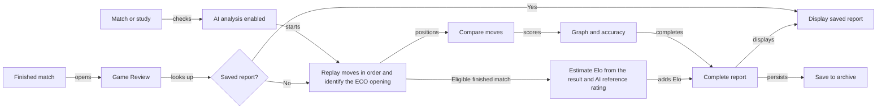
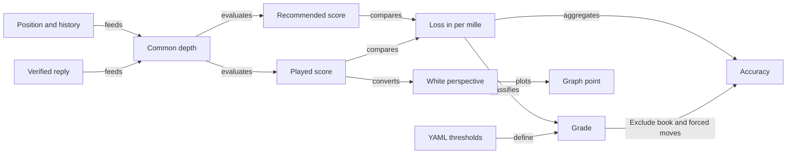
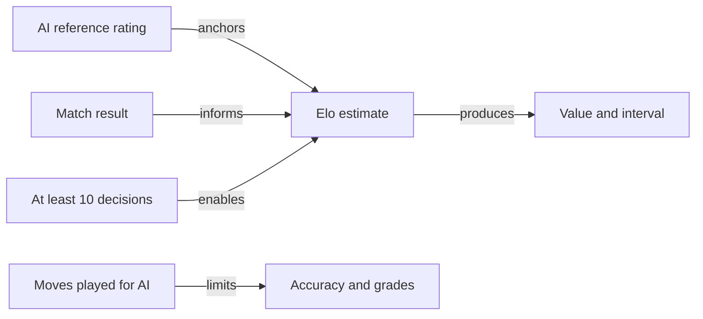
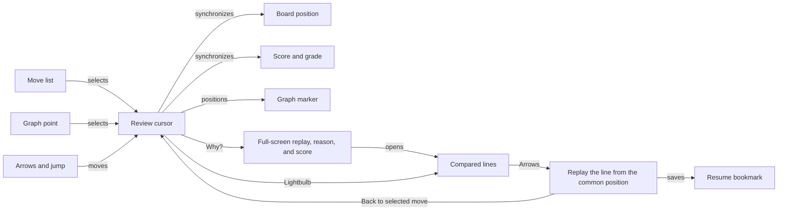

# How Game Review is calculated

## Overview

- **Scope.** `GameReview` calculates grades, accuracy, and the replay of the played and recommended lines. Elo requires an eligible finished match. [Calculation](../../chess-core/src/main/java/ro/atf/chess/GameReview.java)
- **Checks.** `GameReviewTest` checks the calculations, `GameReviewTimelineTest` checks legal replay, and `GameReviewGraphParityTest` checks navigation across surfaces.

- **Game review** is available after a final result, including a draw or resignation. With **AI analysis** enabled, the menu can also analyze the moves recorded so far. **Review all moves** on the study board applies the same search to the explored line. In manual study, the table and accuracy are displayed for White and Black. The interim report and study use positional results, and Elo is calculated for an eligible finished match.

## From match to report



<details>
<summary>Legend — when the report is calculated and saved</summary>

- An active match and study require enabled analysis and at least one move.
- The report calculates grades and accuracy. An eligible finished match adds
  Elo, and saving requires an existing archive entry.

</details>

- The ECO index identifies the last named position, including positions reached by transposition. It separately marks the move prefix that actually follows a book line. A move in that prefix receives the **Book** grade only if its loss against the recommendation is below 100‰. [ECO index](../../chess-core/src/main/java/ro/atf/chess/OpeningIndex.java)

## Evaluating a ply

- A ply is a move by one side. Before each ply, the engine retrieves the position and history. At the search root, it identifies moves that immediately lead to an automatic draw by material, repetition, or the number of plies without a pawn move or capture. Analysis compares the best line found and the played move at the same completed depth. The search starts at three plies and attempts to reach six, with a tactical extension and a budget of 85,000 additional nodes per position. When an iteration exceeds the budget, the previous iteration's result is retained. [Search](../../chess-core/src/main/java/ro/atf/chess/TacticalAnalysis.java) · [Configuration](../../chess-core/src/main/resources/game-review.yaml)



<details>
<summary>Legend — how the scores flow</summary>

- The comparison uses the completed depth for both moves. The graph shows
  each played score from White's perspective.

</details>

- The internal score is relative to the side to move. The engine evaluates ordinary positions in centipawns and assigns extreme scores to provable mates. Analysis converts the score to a 0–1,000 scale and compares the two values.

```text
points(cp) = round(1000 / (1 + exp(-cp / 220)))
loss = max(0, points(recommendation) - points(played move))
```

- For example, if the recommendation scores +220 cp and the played move scores 0 cp, the values are 731‰ and 500‰. The loss is **231‰**. On the graph, 500‰ means balance. For a move by Black, the plotted value is `1000 − points(played move)`, so the upper side always favors White. The first point uses the evaluation of the recommendation in the starting position. [Calculation and graph](../../chess-core/src/main/java/ro/atf/chess/GameReview.java) · [Android display](../../android/app/src/main/java/ro/atf/chess/android/GameReviewDialog.java)

- In exact positions from the verified repertoire, the report recommends the repertoire reply and evaluates both lines at the same completed depth. A proven terminal line or automatic draw at the root keeps priority. If the local evaluation of the played move exceeds the recommendation score, the loss stays zero. [Repertoire](../../chess-core/src/main/resources/ai-repertoire.yaml)

## Grades and accuracy

- The engine checks the rules in the order below. The first applicable rule determines the grade. The table shows the default thresholds from the `classification` section of [game-review.yaml](../../chess-core/src/main/resources/game-review.yaml). Governance tests verify the values, integer units, and threshold order. Previously saved reviews retain their original result. All moves appear in the table, and the player's column remains the first numerical column when they play Black.

| Order | Grade | Condition |
|---|---|---|
| 1 | Book | In the ECO prefix, with a loss below 100‰. |
| 2 | Forced | There is only one legal move. |
| 3 | Brilliant | Score at least equal to the recommendation, depth of at least 4, played score of at least 550‰, and an accepted sacrifice of at least 200 cp in the reply found. Also requires an advantage of at least 100‰ over the estimated alternative or a single proven mate in the search. |
| 4 | Tactically excellent | Score at least equal to the recommendation, depth of at least 4, an advantage of at least 100‰ over the alternative, and a crossed engine evaluation threshold. The recommendation reaches at least 750‰ with the alternative below 700‰, or at least 450‰ with the alternative below 400‰. |
| 5 | Best | The internal score for the move reaches at least the recommendation score. |
| 6 | Missed opportunity | The opponent just lost at least 100‰, the recommendation reaches at least 750‰, and the played move scores at most 550‰. |
| 7–11 | Blunder, mistake, inaccuracy, good, excellent | The thresholds are ≥200‰, ≥100‰, ≥50‰, ≥20‰, and below 20‰, respectively. |

- Accuracy is calculated separately for each side from losses on moves with a choice. Book and forced moves are excluded.

```text
accuracy = round(100 - total losses / (10 × number of moves with a choice))
```

- With two eligible moves losing 231‰ and 50‰, the rounded accuracy is **86%**. With no eligible moves, the field remains blank. [Classification and aggregation](../../chess-core/src/main/java/ro/atf/chess/GameReview.java)

## How Elo is estimated



<details>
<summary>Legend — eligibility for an Elo estimate</summary>

- The reference rating and result produce an estimate when there are enough
  moves with a choice. Playing moves on behalf of the AI limits the report
  to positional data.

</details>

- Estimated Elo uses the outcome and the reference rating of the AI profile. For the player, `s` is 1 for a win, 0.5 for a draw, and 0 for a loss. The formula applies after at least ten moves with a choice.

```text
p = (1 + s) / 3
Elo difference = round(400 × log10(p / (1 - p)))
estimate = reference Elo + Elo difference
```

- The single result updates a uniform expected-score distribution to `Beta(1 + s, 2 − s)`. The display adds the Elo differences from the 5% and 95% quantiles to the ends of the AI reference interval. For example, a loss against **Advanced**, with a reference of 1461 and enough decisions, yields **≈1341 (549–1900)**. The interval reflects how little information a single match provides. The AI reference comes from the local calibration protocol with Stockfish. [External calibration](ai-quality.md#external-anchor-results) · [Configuration](../../chess-core/src/main/resources/game-review.yaml)

## Saving and verification

- The finished review is stored alongside the archived match. The cache has a version and the SHA-256 hash of the exact save, including the result and configuration. A missing, truncated, or incompatible review is recalculated on reopening.
- The archived report includes the scores and calculated lines for each move. The bookmark preserves the ply, line, step, and **Why?** window state across reopening or restart. Explicitly closing the window leaves the move selected in history. The archive ID and save hash bind the bookmark to the exact match. The first opening starts at the end. An unavailable line or step returns the board to the played position.
- Closing the window during calculation stops the search. The archive keeps the ten most recent results and removes the report and bookmark with the oldest entry. Continuing from the archive creates a separate match.
- `GameReviewTest` verifies evaluation, grading, Elo estimation, and table reconciliation. `GameReviewGovernanceTest` checks thresholds, reference ratings, and the ECO catalog. `MatchArchiveTest` verifies restoration of the full report and rejection of incompatible caches. [Test strategy](../testing/README.md#game-and-history)

## Review navigation and recommended lines

- Game Review measures usable window space after accounting for the header and system areas. In portrait, the board is the largest square that leaves room for the controls and the start of the scrollable report. In a wide window, the report moves to the side when it stays readable and the board can grow. The cursor, hint, and opening name may change without moving the board.

- The arrows move by one ply, and **Next key moment** jumps to the next marked position. The list and graph support direct selection. The board, notation, grade, scores, and graph marker follow the same cursor. The arrows are disabled at the endpoints. The toolbar uses 48 dp targets and accessible labels in Romanian and English. In very narrow windows, the toolbar scrolls horizontally. Score details, graph, accuracy, Elo, comparison, and the move list scroll together.

- Plotted points and touches use the same horizontal projection, including the graph insets. Tapping selects the nearest ply and synchronizes the marker, board, and highlight in the move list. The starting position has no list row. A tap in the margins selects the starting or ending position. The accessibility action for a row scrolls directly to the requested move, including in a long match.

- The identified opening name appears when the review opens. The first navigation action or line activation removes it from the report. **Opening details** in the actions menu shows the name and ECO code on demand.



<details>
<summary>Legend — review cursor and lines</summary>

- The list, graph, and arrows send the selection to the same cursor.
- The lines preserve the origin move and selected step for reopening.

</details>

- The lightbulb opens the recommended line directly in Game Review. For a move that loses score, **Why?** opens the same full-screen window as Opening Theory. The board and arrows remain fixed, and the explanation scrolls separately. **After move** and **Recommended** both start at the position before the selected move. The first move in **After move** is the one played in the match, and the continuation includes the calculated replies. **Back** restores the selected move and returns the graph and list to their previous positions. [Opening theory on the analysis board](openings.md#opening-theory-hints-on-the-analysis-board)

- For a move that loses score, the explanation uses lines validated against the rules and position history. In the `g4` example, the played line shows `…Qh4#`. For mate by promotion, the explanation names the piece that reached the last rank. For material, it compares branches at the same step count and names the capture that causes the greatest loss still present at the end of the comparison. The net deficit describes the whole comparison. When the recommended branch proves a missed material gain at the same horizon, the explanation names the capture and the value that remains after the defense. When tactical proof is unavailable, the explanation shows the played evaluation, the recommended evaluation, and their common depth from the side-to-move perspective. An illegal cached line remains unavailable. [Move check](../../atf-tests/src/test/java/ro/atf/chess/GameReviewTimelineTest.java)

- In the actions menu, **Show on board** closes Game Review and sets the active cursor to the selected ply. **Try this move again** asks for confirmation before continuing from the previous position for the player's moves, or for either side in study. Cancellation or a lack of free slots keeps the analysis on the current line and step. Confirmed continuation from the archive opens a new match from the original prefix.

- `GameReviewTimeline` validates each move and side against the source. `GameReviewLayout` chooses the geometry from measured dimensions. Component checks and the Android flow verify synchronization, line navigation, and preservation of the match. [Sanity and Extent](../testing/README.md#game-and-history)

## Measured review limitations

The paired 18 November study runs actual `GameReview.analyzeLine` on three capped opening games. It preserves all 60 moves, legal played and recommended PVs, and the absence of study Elo. The played roots have independent Stockfish H17/H19 evidence. Nine disagreements persist at both horizons: three native-positive labels accompany a loss of at least 150‰, and six native severe labels accompany less than 10‰ loss. This does not grade every review alternative independently.

Caro–Kann `6.e6` is BEST with White accuracy 100 while the played root loses 533‰ / 581.5‰. Sicilian `5.Nc3` is BLUNDER with 0‰ / 0‰ loss. These are full-history regression witnesses for comparison and grading, not navigation or archive failures. Local logistic loss points and oracle WDL are distinct models; a legal replay does not certify the classification. [Paired evidence and interpretation](../testing/hard-hint-study.md) · [Open correction criteria](../feedback/README.md)
