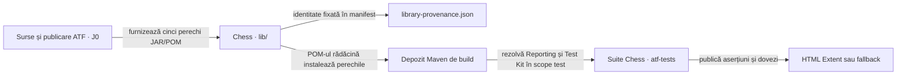

# Bibliotecile ATF

Acest director documentează adoptarea bibliotecilor ATF în testele Chess Lab.
Implementarea și regresiile generice aparțin J0; J7 verifică integrarea proprie.

## Proveniență

Legendă · Cum ajung bibliotecile ATF în rapoartele Chess

- [POM-ul rădăcină](../pom.xml) instalează perechile. [Manifestul de proveniență](../library-provenance.json)
  fixează identitatea fișierelor, verificată de [testul de proveniență](../atf-tests/src/test/java/ro/atf/chess/PlatformLibraryProvenanceTest.java).
- [POM-ul testelor](../atf-tests/pom.xml) declară Reporting și Test Kit în
  scope `test`. [Guvernanța Extent](../atf-tests/src/test/java/ro/atf/chess/ExtentGovernanceTest.java)
  verifică diagnosticul și probele negative din raportul produs de Chess.
- [Buildurile de produs](../web/README.md#motor-comun-și-adaptoare-de-platformă)
  consumă sursele `chess-core`, cu adaptoare native și Web proprii. JAR-urile
  ATF aparțin suitei JVM care raportează probele de pe aceste platforme.

## Ghiduri de utilizare

| Bibliotecă | Utilizare |
|---|---|
| [Core](README.Core.md) | Configurație, HTTP și JSON. |
| [Reporting](README.Reporting.md) | Rapoarte Extent/fallback, aserțiuni și dovezi. |
| [Console](README.Console.md) | Evenimente și diagnostic în Maven și IntelliJ. |
| [Mock](README.Mock.md) | Contracte HTTP deterministe, cu un catalog local. |
| [Test Kit](README.TestKit.md) | Lifecycle și audit JUnit. |

## Mentenanță și feedback

Raportați integrarea Chess Lab în [feedback-ul J7](../docs/feedback/README.md).
Pentru un defect al bibliotecii, izolați proba la ownerul J0 și repetați
acceptanța consumatorului după înlocuirea perechii.
