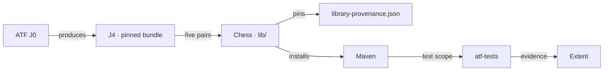

# ATF Libraries

## Overview

This directory documents how the Chess Lab tests use the ATF libraries.
J0 owns implementation and generic regression tests. Chess verifies its own integration.

## Provenance



<details>
<summary>Legend · How the ATF libraries reach Chess reports</summary>

- J0 produces the libraries. The provenance manifest also records the J4
  commit that supplied the five vendored JAR/POM pairs.
- The [root POM](../pom.xml) installs the pairs. The [provenance manifest](../library-provenance.json)
  pins file identity, which the [provenance test](../atf-tests/src/test/java/ro/atf/chess/PlatformLibraryProvenanceTest.java) verifies.
- The [test POM](../atf-tests/pom.xml) declares Reporting and Test Kit in
  `test` scope. [Extent governance](../atf-tests/src/test/java/ro/atf/chess/ExtentGovernanceTest.java)
  verifies diagnostics and negative evidence in the report produced by Chess.
- The [product builds](../web/README.md#shared-engine-and-platform-adapters)
  consume the `chess-core` sources with their own native and Web adapters.
  The ATF JARs belong to the JVM suite that reports evidence from those platforms.

</details>

## Usage Guides

| Library | Use |
|---|---|
| [Core](README.Core.md) | Configuration, HTTP, and JSON. |
| [Reporting](README.Reporting.md) | Extent and fallback reports, assertions, and evidence. |
| [Console](README.Console.md) | Events and diagnostics in Maven and IntelliJ. |
| [Mock](README.Mock.md) | Deterministic HTTP contracts with a local catalog. |
| [Test Kit](README.TestKit.md) | JUnit lifecycle and auditing. |

## Verification

Run from the TMP checkout. Provenance checks the installed pairs against the
manifest. Extent governance checks the reporting contract used by Chess.

```powershell
mvn -pl atf-tests -am test '-Dtest=PlatformLibraryProvenanceTest,ExtentGovernanceTest' '-Dsurefire.failIfNoSpecifiedTests=false'
```

J0 owns the behavior of the library examples. [Executable J0 guides](https://github.com/crististefanita/atf_j0/blob/master/docs/ATF_Platform_Libraries.md)

## Maintenance and Feedback

Report Chess Lab integration issues in [Chess feedback](../docs/feedback/README.md).
For a library defect, isolate the reproduction with the J0 owner and repeat
consumer acceptance after replacing the pair.
