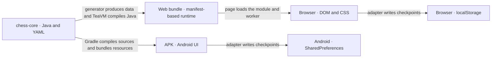

# The Chess Lab engine in the browser

## Overview

Chess Lab runs the same Java engine on Android and in the TeaVM worker. Each adapter owns its own input, rendering, navigation, and local storage.

- [APK–Web parity matrix](parity.md) lists the shared behavior and the evidence needed on each platform.
- [Build and verification](#build-and-verification) compares the generated Web bundle with the JVM.
- [Feedback on Web–Android flows](../docs/feedback/web-parity.md) tracks open issues.

<details>
<summary>Resource generation and worker portability</summary>

The Web build compiles the Java 17 engine with TeaVM 0.15.0 into an ES module. The worker runs the rules, catalogs, local match, and analysis commands.

- On the JVM and Android, the loader reads YAML from the classpath. The Web build passes the same resources through SnakeYAML 2.2 during generation, rejecting duplicate keys and collection aliases. The generated data preserves types, order, and text. The ECO index retains the original bytes. The Web compiler receives the portable loader and engine classes. SnakeYAML stays in the generation step. [Web loader](src/main/java/ro/atf/chess/ChessResourceLoader.java) · [Generator](tools/GenerateChessResources.java)

- In the code under test, using SnakeYAML in the browser prevented rule initialization at `System.getLogger`. Generation resolves the dependency at build time. Checkpoint serialization retains the existing format through a `StringBuilder` that also works in the TeaVM runtime. The same cases verify the starting position, castling, en passant, promotion, game results, checkpoint restoration, openings, and puzzles.

</details>

## Shared engine and platform adapters

Android and Web use the same rules, catalogs, and Java match contracts from
`chess-core`. Each platform adapter owns its own screens, board, and
navigation.



<details>
<summary>Legend · From the engine to both applications</summary>

- Gradle bundles the YAML resources in the APK. The native adapter renders
  through Android `View` and wires `MatchStore` to app preferences.
  [Gradle](../android/app/build.gradle) · [Native storage](../android/app/src/main/java/ro/atf/chess/android/AndroidGamePreferences.java)
- The Web generator reads the same YAML files at build time. TeaVM compiles
  the engine and Java adapter into an ES module, and the browser runs it
  in the worker. The UI converts input to commands and saves state for the
  Web origin. [Build](Build-ChessWeb.ps1) · [Worker](src/main/web/engine-worker.mjs)
- Portable cases compare results on the JVM and in the bundled worker.
  Adapter tests measure position, controls, and accessibility for each
  UI. [Contracts and checks](parity.md#contracts-and-checks)

</details>

## Build and verification

- Run from the root of the Chess checkout in TMP using PowerShell 7, JDK 21, Maven, and Node.js. Choose `$workRoot` in a directory outside the checkout.
- The build writes generated data, compiled output, and the `site` bundle there. For a complete local cache, add `-Offline` to the build and `-o` to Maven.
- [Working-file location](../docs/README.md#maintenance-rules)

Use the MCP browser for visual acceptance. The Edge command-line examples
below document the existing optional driver; run them only when that browser
route is permitted. Record the method actually used and keep unexecuted
rendering checks open. JVM and worker results qualify their own contracts.

```powershell
$site = ./web/Build-ChessWeb.ps1 -WorkRoot $workRoot
$report = Join-Path (Split-Path -Parent $site) 'web-parity.html'
mvn -B -ntp -pl atf-tests -am test '-Dtest=ChessWebRulesComponentTest,ChessWebParityPublication,SuiteGovernanceTest' '-Dsurefire.failIfNoSpecifiedTests=false' "-Dchess.web.bundle=$site" "-Dchess.extent=$report"
```

The explicit check requires the compiled bundle and compares actual JVM and worker results for the same resources and positions. The report identifies each data and rules group. The JVM check remains in the component suite. [Web parity](../docs/testing/README.md#web-engine-parity)

### Web bundle identity

- The `index.html` page loads styles and the entry module from `runtime/<SHA-256>/`. The full identifier comes from the sorted manifest of runtime files.
- Every manifest entry binds a relative path to a content hash. CSS, JavaScript modules, the worker, and the TeaVM engine belong to the same directory.
- Relative imports and worker startup stay in that directory, including after in-app navigation.

A build with the same manifest uses the same directory. A runtime file
change produces a new URL. The game URL stays the same.
[Publishing and retaining versions](parity.md#publishing-the-link)

## AI match

Color, difficulty, and automation belong to the saved match slot. Changing the name, language, or board orientation keeps the current position.

<details>
<summary>Setup, local preferences, and reload probe</summary>

- **New game vs computer** opens the same choices as Android, with White, Black, or Random and the Basic, Advanced, and Hard levels. The worker chooses a random color once at game creation and stores the result and level in the checkpoint.
- The browser saves the current turn before displaying the move and schedules a search after the 650 ms pause when automatic replies are enabled. After reload, the position and saved automation determine whether an AI reply follows.
- The worker rejects stale revisions, and an already saved reply leaves the player to move.

- Under **Game options**, **Flip board** changes perspective at the same position, including in history. An active match stores orientation in its slot and restores it on reopening.
- When previewing an archived match, **Continue from here** passes the displayed orientation to the new slot. The archive keeps its saved orientation.
- [Orientation verification](../docs/testing/README.md#board-orientation-in-a-game)

- From the main menu, change the language in **Settings** and the display name in **Name**. Saving the language reopens the same menu, including when the browser stores a review.
- Return to the main menu to edit **Name** or **Settings**, then reopen the saved match. The browser stores the profile separately, so the match checkpoint is preserved.
- The default language is English, and a blank name shows **You** or **Tu** depending on the language. `ChessWebShellTest` verifies reload with mocked storage, history, and URL.
- [Test strategy](../docs/testing/README.md)

Use `$site`, `$edge`, and a fresh `$evidence` directory in TMP.

```powershell
node ./web/tests/browser-game-review.mjs $site --ai $evidence $edge
$receipt = Join-Path $evidence 'result.json'
mvn -B -ntp -pl atf-tests test '-Dtest=ChessWebBotPublication' "-Dchess.web.bundle=$site" "-Dchess.web.bot.receipt=$receipt"
```

- The check starts the browser under `/chess/`, reloads on the computer's turn, and verifies the move with the JVM. It then changes the name and language, reloads, and confirms the match has the same checkpoint.
- The report embeds the screenshots. To check the public destination, pass the README URL as the last Node argument and add `-Dchess.web.bot.public=true` when publishing to Extent.
- The driver verifies the served files before the Edge check. [Android check](../docs/testing/README.md#game-and-history)

</details>

### AI reply control

- At the current position of an AI match, clear **Let AI play its moves** to play for the computer's side as well. The checkbox is inactive while navigating history.
- The choice is saved in the same slot and applies on reopening. The browser computes the reply separately from saving it.
- Disabling replies cancels the scheduled reply or calculation in flight. Re-enabling them on the AI's turn requests exactly one reply, saved only at the current revision.

- Match type, current automation, and the marker for manually played AI-side moves are distinct fields. Playing a legal move for the computer makes the match ineligible for the Elo estimate.
- Switching and resuming automation retain identity and eligibility. Game Review can analyze the match and continue an archived AI match with automatic replies, retaining the marker used for the Elo estimate.
- Older libraries retain the classification used by the version that saved them. [Shared JVM and TeaVM checks](../docs/testing/README.md#controlling-ai-replies)

### Analysis in an AI match

- When setting up a new match, enable analysis to display the evaluation bar and in-game hints. The checkbox starts cleared.
- The choice belongs to the slot and is retained on reopening. In any match, study the position separately and play both sides through **Analysis board** in game options.

- The bar spans the full height of the board's left edge. The score appears above history, and the lightbulb sits beside the arrows, including at the starting position.
- Bar color follows board orientation, and the score uses White's perspective. Navigating history recalculates the evaluation for the displayed position.
- The final position shows the match result.

- The lightbulb clears the current selection and shows the recommended move. The suggestion button opens the line on the preview board, where arrows step through the moves without changing the match.
- **Calculated line**, puzzle replay and Analysis board previews inherit the visible source board's side before opening. Stepping or switching lines retains that ceiling; reopening measures the current source again. A shorter window may shrink the preview to keep controls visible. The explanation scrolls separately.
- Closing returns to the history ply, and reopening the slot resumes at the end of the match with the hint hidden. The analysis board also offers opening theory.
- At the current position, tapping the marked destination plays the legal hint when there is no board selection. The browser calculates analysis in a separate worker.
- Changing the position or leaving the match invalidates the previous result. [Component and UI checks](../docs/testing/README.md#analysis-in-the-ai-game)

### The board in puzzles and matches

- In a mobile AI match, the board and evaluation bar together use the full usable width when width limits the square's side. When analysis is enabled, the bar and its gap occupy a strip on the left.
- In a shorter window, the available height leaves room for the score, history, and lightbulb. Navigating history and reopening the slot retain the board rectangle.
- [Compact RO/EN check](../docs/testing/README.md#analysis-in-the-ai-game)

Puzzles size the board from the available space after reserving room for
controls and the explanation. [Size verification](../docs/testing/README.md#web-engine-parity)

## Saved and finished matches

The lists separate active slots from archived results. The selected ply and continuation depend on which list opened the match.

<details>
<summary>Storage, history, and browser proof</summary>

- **Saved games** shows only active matches. **Finished games** shows only archived results.
- Both lists use `MatchStore` and keep at most ten entries each, newest first. The UI displays the date, ply count, and profile.
- In an AI match, the result is from the player's perspective.

- The board arrows change the displayed position. **Continue from here** asks for confirmation and keeps moves through the selected position.
- For an active match, it rewrites the current slot. From the archive, it starts a separate match in a free or reusable slot and keeps the source.
- When all slots are active, the user stays at the selected position. In an AI match, confirmation can keep automatic replies enabled or switch to manual control.

- The browser stores the library as one versioned local record. On first opening, it saves local and AI matches from the previous Web version together.
- On later openings, it reads the saved library. Changing the match or the history position invalidates commands from the previous revision.
- [APK–Web parity matrix](parity.md#contracts-and-checks)

Use `$site`, `$edge`, and a fresh `$evidence` directory in TMP.

```powershell
node ./web/tests/browser-game-review.mjs $site --ledger $evidence $edge
$receipt = Join-Path $evidence 'result.json'
mvn -B -ntp -pl atf-tests test '-Dtest=ChessWebLedgerPublication' "-Dchess.web.bundle=$site" "-Dchess.web.ledger.receipt=$receipt"
```

For the public destination, pass the URL from the README as the last Node argument and add `-Dchess.web.ledger.public=true` when publishing to Extent.

</details>

### Resuming an archived match review

- From **Finished games**, open the match and choose **Analyze game**. The first opening saves the analysis under the match ID and checkpoint.
- **Open analysis** preserves the move, branch, step, and **Why?** state, including after page reload. Removing the entry at the ten-match limit also removes its analysis.
- An analysis in the previous format is attached automatically once when the checkpoint identifies exactly one entry. Standalone analyses remain available from Game Review.
- [Component checks](../docs/testing/README.md#resuming-game-review-on-android-and-the-web)

The Edge check computes two distinct analyses with the real worker and verifies both positions after reload. Use a fresh evidence directory when checking the public destination as well.

```powershell
node ./web/tests/browser-game-review.mjs $site --archives $evidence $edge
$receipt = Join-Path $evidence 'result.json'
mvn -B -ntp -pl atf-tests test '-Dtest=ChessWebArchiveReviewsPublication' "-Dchess.web.bundle=$site" "-Dchess.web.archive.reviews.receipt=$receipt"
```

For the public destination, pass the URL from the README as the last Node argument and add `-Dchess.web.archive.reviews.public=true` when publishing to Extent.

### Continuing from Game Review

- In the review of a finished match, select a position from the played history and confirm **Continue from here**. The match starts immediately after the selected ply in a free or reusable slot, with the original analysis and resume position preserved.
- When **Why?** or a line is open, return to history. The final position offers no continuation.
- For AI matches, confirmation can retain automatic replies. When all ten slots are active, the review stays open.

The Edge check verifies the flow, the new match's save, and the original archive after reload. Use a fresh evidence directory.

```powershell
node ./web/tests/browser-game-review.mjs $site --review-continue $evidence $edge
$receipt = Join-Path $evidence 'result.json'
mvn -B -ntp -pl atf-tests test '-Dtest=ChessWebArchiveContinuationPublication' "-Dchess.web.bundle=$site" "-Dchess.web.archive.continuation.receipt=$receipt"
```

For the public destination, pass the URL from the README as the last Node argument and add `-Dchess.web.archive.continuation.public=true` when publishing to Extent. [Component and sanity checks](../docs/testing/README.md#saved-games-archive-and-continuation)

### Game Review graph

Selecting a point on the graph selects the same ply on the board and in the list. The 185-ply fixture checks that late moves remain reachable.

<details>
<summary>Long game fixture and browser check</summary>

- The board and controls stay fixed, and the report scrolls separately, as in the APK. The graph uses White's score, a neutral axis, a marker for the selected position, and the same touch calculation as Android.
- A touch selects the same ply on the board, in the move list, and in the archive bookmark. Web and Android draw the pieces from the same Staunton outlines.
- New reviews of eligible AI matches also use the APK's Elo estimate.

Generate the 185-ply fixture in TMP. The driver verifies touch at two widths, including point 184, then reloads the page and verifies the retained position and review.

```powershell
$cpFile = Join-Path $workRoot 'graph-classpath.txt'
mvn -B -ntp -pl atf-tests test-compile org.apache.maven.plugins:maven-dependency-plugin:3.8.1:build-classpath "-Dmdep.outputFile=$cpFile"
$dependencies = (Get-Content -LiteralPath $cpFile -Raw).Trim()
$cp = @('atf-tests/target/classes', 'atf-tests/target/test-classes', $dependencies) -join [IO.Path]::PathSeparator
$fixture = Join-Path $workRoot 'review-graph.json'
java -cp $cp ro.atf.chess.GameReviewGraphFixture $fixture
node ./web/tests/browser-game-review.mjs $site $fixture $evidence $edge
$receipt = Join-Path $evidence 'result.json'
mvn -B -ntp -pl atf-tests test '-Dtest=ChessWebReviewGraphPublication' "-Dchess.web.bundle=$site" "-Dchess.web.graph.fixture=$fixture" "-Dchess.web.graph.receipt=$receipt"
```

For the public destination, pass the URL from the README as the last Node argument and add `-Dchess.web.graph.public=true` when publishing to Extent. [Component and sanity checks](../docs/testing/README.md#saved-games-archive-and-continuation)

</details>

### Keyboard navigation in Game Review

- Tab moves through the board, available controls, graph, and selected row. The graph arrows keep focus on the graph and synchronize the board and history.
- In the list, Up and Down, Home, and End change the position and move focus to the resulting row. **Why?** opens replay with focus on **Back**.
- Closing it restores focus to **Why?** and keeps the ply and report position.

Run the focus component tests with Node through Maven. Extent records each expected contract. The Edge check uses the keyboard at 1.3× text scale on the same four-ply mate position used for APK qualification. [Test strategy](../docs/testing/README.md#saved-games-archive-and-continuation)

```powershell
$componentReport = Join-Path $workRoot 'review-focus-components.html'
mvn -B -ntp -pl atf-tests test '-Dtest=ChessWebReviewAccessibilityTest' "-Dchess.extent=$componentReport"
$focusFixture = Join-Path $workRoot 'review-focus.json'
java -cp $cp ro.atf.chess.GameReviewArchiveFixture $focusFixture --focus
node ./web/tests/browser-game-review.mjs $site $focusFixture $evidence $edge
$receipt = Join-Path $evidence 'result.json'
mvn -B -ntp -pl atf-tests test '-Dtest=ChessWebReviewFocusPublication' "-Dchess.web.bundle=$site" "-Dchess.web.focus.fixture=$focusFixture" "-Dchess.web.focus.receipt=$receipt"
```

Use the classpath from the graph check and a fresh evidence directory. For a public deployment, pass the URL from the README as the last Node argument and add `-Dchess.web.focus.public=true`.

### Screen readers in Game Review

- The graph exposes the position, recorded move, and White's score. The current row announces the move and position.
- **Back** from **Why?** returns focus to the trigger and preserves the ply. `ChessWebReviewAccessibilityTest` checks the RO and EN mapping and the choice of announcement channel.
- Use one source for each action's message through the control's value, focus, or status region.

The Edge check records values and focus changes from the browser accessibility tree. Use the keyboard check fixture and a fresh directory for each language.

```powershell
node ./web/tests/browser-game-review.mjs --accessibility $site $focusFixture $evidence $edge
$receipt = Join-Path $evidence 'result.json'
mvn -B -ntp -pl atf-tests test '-Dtest=ChessWebReviewAccessibilityPublication' "-Dchess.web.bundle=$site" "-Dchess.web.accessibility.fixture=$focusFixture" "-Dchess.web.accessibility.receipt=$receipt"
```

For the public check, pass the URL from the README as the last argument and add `-Dchess.web.accessibility.public=true`. For a speech check, record the reader, language, and messages actually sent to the synthesizer. [Test strategy](../docs/testing/README.md#talkback-probe)

## Main menu and pieces

- **Play in your browser** in the README opens the **Chess Lab** main menu, including when matches or a review have been saved. Groups follow the APK order.
- **Saved games** appears when there are active matches, and **New game vs computer** opens setup. Explicit URLs such as `#ai`, `#openings`, and `#review` open the requested screen.
- **Profile** validates the name through `PlayerProfile`, and **Settings** stores the language in the browser. [Feature matrix](parity.md#contracts-and-checks)

- The home screen ends with Name and Settings.
- Imported reviews and their resumption controls live on the review screen
  at `#review`. An existing match review reopens from its match or archive.

- The local match, AI match, and Game Review use the shared silhouettes and details in `ChessPieceArtwork`. Web receives the outlines from the worker and draws them in the APK's 48 × 48 coordinate space.
- `ChessWebShellTest` verifies order and RO/EN text against Android resources, mocked persistence, and SVG reuse. The MCP sanity check opens the menu and verifies all six piece types before the first move.
- [Test strategy](../docs/testing/README.md#game-and-history)

## Study

- The **Study** menu opens **Puzzles**, **Openings**, and **Analysis board**. These screens use the shared board, the same pieces as Android, and RO/EN controls.
- Keyboard arrows move through squares in display order. The first hint stage marks the piece, and revealing the destination adds the arrow in both orientations.

- **Puzzles** (`#puzzles`) uses the APK catalog, including Mate in 1, 2, and 3. `QuestStore` and `QuestRewards` store the current puzzle by chapter, the stage, results, and points locally. The hint first shows the piece, then the destination. **Next** is enabled after solving. The explanation has its own scroll area.
- **Openings** (`#openings`) uses the catalog and `OpeningLesson` for positions, moves, history, and the book reply. Select the lesson explanation to see the full text. In AI analysis, the comparison opens the decisive move when it appears in the verified line.
- **Analysis board** (`#analysis`) uses `AnalysisLine` for moves, branching, and the cursor. The evaluation bar sits on the left, and the selection stays visible in the history and controls row. Game Review returns to the selected position. **Continue as a saved game** reserves a free slot and keeps the orientation and AI reply setting.

- In puzzles and matches, the three-line menu opens below its button without moving the board. Escape closes the menu and returns focus to the button.
- Clicking outside closes it. The Openings board uses the same limit based on window size and reserves space for the evaluation bar, explanation, and controls.

### Explanations and upgrade progress

- **Tactics**, **Tactical training**, and **In-between move** use the same `QuestPayoff` line as the APK. Replay shows the move, capture, material balance, and the lesson or defense study when available.
- **Danger** marks the verified square and announces the reason separately. The arrows move through replay without changing the solved status or score.

- The upgrade check starts from the public bundle and solves one puzzle each in Tactics and In-between move. It leaves Tactical training after the opponent's first reply, then serves the candidate at the same URL.
- Reload must preserve the exact position, the two solved puzzles, and the 20 points. Solving the remaining puzzle must raise the total to 30.
- In the component, `material-progress-previous.json` contains a save produced by the previously published Pages bundle, with the source revision and reference positions.

### AI match options

The AI match menu uses the same command projection as Android. Verify shared match results before probing platform navigation.

- Name and new-game setup are reached from the main menu. The area below an
  active AI board contains the game's controls and analysis.
- Three-line menus open beside their trigger. The shared placement uses the
  visible viewport, opens above when needed, and scrolls long lists internally.
  Escape and outside dismissal close the panel, with focus restored on request.

<details>
<summary>Mocked commands, browser flows, and Extent</summary>

- The menu follows the APK's `MatchControls`. **Analysis board** opens at the displayed position. **Game review** is available at the end and during play when **AI analysis for a new game** was enabled and the game has moves. History retains navigation actions. An accepted draw and a confirmed resignation keep the same ID in the archive. If the AI declines an offer, the match continues from the same position.

- The **Analysis board** command from an active or finished match uses `AnalysisEntry`. Study starts at the displayed ply and retains orientation.
- **Back** returns to the same match with selection and focus restored. Contextual study has its own bookmark for the visit, and reloading the URL opens standalone study.
- [Shared JVM and Web cases](../docs/testing/README.md#analysis-board-from-a-game)

Tests with mocked storage and controls run in the TMP checkout. For the integrated check, pass the TeaVM bundle. The test runs the worker commands through Node.js.

```powershell
mvn -B -ntp -pl atf-tests test '-Dtest=ChessWebStudyShellTest,ChessWebQuestStudyTest,ChessWebOpeningStudyTest,ChessWebAnalysisStudyTest' "-Dchess.study.bundle=$site" "-Dchess.extent=$report"
```

For the visual check, use the MCP browser at 360 × 640 CSS px with text at 130%, then at 1280 × 900 CSS px with text at 100%. The native compact reference is APK 0.15.2 at 720 × 1280, 320 dpi, and 1.3× text scale. Record the usable window size and keep the same position and language in both screenshots.

| Flow | MCP browser verification |
|---|---|
| Puzzles | Solve one puzzle each in Mate in 1, 2, and 3. Verify both hint stages, resume after a defense, and points after reload. Measure the board before and after opening the menu, then check that Escape restores focus. |
| Openings | Open the Italian lesson. Verify the board position before and after a hint, the bar fit, and access to controls on compact, desktop, and short landscape windows. |
| Analysis board | Play a line long enough to require scrolling. Select a step in history, verify the bar, position, and selected row, then open Game Review and return. |

Also test changing the URL among the three Study destinations, then using the browser's Back and Forward controls. `ChessWebStudyPublication` embeds images in Extent and verifies the profile, original hash, and provenance of the Android frames. Native screenshots from other releases or profiles serve as references and leave the full visual verdict open.

```powershell
mvn -B -ntp -pl atf-tests test '-Dtest=ChessWebStudyPublication' "-Dchess.web.study.browser=$browserReceipts" "-Dchess.web.study.native=$nativeReferences" "-Dchess.web.study.source=$sourceCommit" "-Dchess.web.study.extent=$report"
```

[Parity matrix](parity.md#contracts-and-checks) · [Published release evidence](../release/README.md)

</details>

## Local match and fresh analysis

- **Local game** accepts moves from both sides and offers a choice of promotion piece. The worker validates every move.
- The page saves the canonical checkpoint before displaying the resulting position. Reload starts a new worker and restores the history, side to move, and legal moves from the checkpoint.
- [Feature matrix](parity.md#contracts-and-checks)

- **Analyze game** captures the confirmed checkpoint and calculates the report with `GameReview.analyzeLine` at the budget from `game-review.yaml`. A dedicated worker reports progress by ply.
- **Cancel analysis** stops the calculation worker, and the match can continue from the same checkpoint. The page accepts the finished review when the match still matches the analyzed snapshot.
- The local game report has no Elo estimate. [Analysis policy](../docs/board/game-review.md#evaluating-a-ply)

With the build's `$site`, `$edge` pointing to the Edge executable, and a fresh `$evidence` directory in TMP, play the match through the UI and publish the receipt. Extent verifies resume, the fresh review, and screenshots bound to the tested bundle. [Shared and native checks](../docs/testing/README.md#resuming-game-review-on-android-and-the-web)

```powershell
node ./web/tests/browser-game-review.mjs $site --active $evidence $edge
$receipt = Join-Path $evidence 'result.json'
mvn -B -ntp -pl atf-tests test '-Dtest=ChessWebGamePublication' "-Dchess.web.bundle=$site" "-Dchess.web.game.receipt=$receipt"
```

## Game Review

- Serve the `site` directory over HTTPS or on `localhost`, where Web Crypto can calculate SHA-256. Open Game Review and load a JSON archive with `id`, `checkpoint`, `review`, and optionally `bookmark`.
- `review` is the cache that `GameReviewCodec` produced for the same finished match. The tests generate a reproducible archive with `GameReviewArchiveFixture`.

- `GameReviewSession` uses `GameReviewTimeline` on Android and in the worker. Commands select the ply, open **Why?**, switch branches, and step through the line. A command with a stale revision preserves the current state. Closing the explanation returns to the selected move. Each platform stores its progress locally. The browser keeps imported reviews and active-match reviews in the Game Review space. It keeps reviews of finished matches in the library entries. [Navigation contract](../docs/board/game-review.md#review-navigation-and-recommended-lines)

Run the component tests first, then the Edge check on the real build and the Extent publisher. On Android, `-GameReviewOnly` retains gesture and process-restart coverage. [Game Review strategy and evidence](../docs/testing/README.md#resuming-game-review-on-android-and-the-web)

After running the tests above, choose `$fixture` and a fresh `$evidence` directory in TMP. Set `$edge` to the Edge executable.

```powershell
$cpFile = Join-Path $workRoot 'game-review-classpath.txt'
mvn -B -ntp -pl atf-tests dependency:build-classpath "-Dmdep.outputFile=$cpFile"
$classes = (Resolve-Path atf-tests/target/classes, atf-tests/target/test-classes).Path
$runtimeClasspath = ($classes + (Get-Content -LiteralPath $cpFile -Raw).Trim()) -join [IO.Path]::PathSeparator
java -cp $runtimeClasspath ro.atf.chess.GameReviewArchiveFixture $fixture
node ./web/tests/browser-game-review.mjs $site $fixture $evidence $edge
$receipt = Join-Path $evidence 'result.json'
mvn -B -ntp -pl atf-tests test '-Dtest=ChessWebReviewPublication' "-Dchess.web.bundle=$site" "-Dchess.web.review.fixture=$fixture" "-Dchess.web.review.receipt=$receipt"
```
