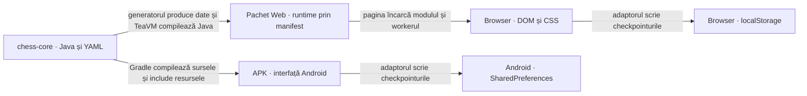

# Motorul Chess Lab în browser

## Pe scurt

Chess Lab rulează același motor Java pe Android și în workerul TeaVM. Fiecare adaptor răspunde de interacțiuni, randare, navigare și stocare locală.

- [Matricea APK–Web](parity.md) enumeră comportamentul comun și dovezile necesare pe fiecare platformă.
- [Build și verificare](#build-și-verificare) compară pachetul Web generat cu JVM-ul.
- [Feedback pentru fluxurile Web–Android](../docs/feedback/web-parity.md) urmărește problemele deschise.

<details>
<summary>Generarea resurselor și portabilitatea workerului</summary>

Buildul Web compilează motorul Java 17 cu TeaVM 0.15.0 într-un modul ES. Workerul execută regulile, cataloagele, partida locală și comenzile pentru analiză.

- Pe JVM și Android, încărcătorul citește YAML de pe classpath. Buildul Web trece aceleași resurse prin SnakeYAML 2.2 în etapa de generare, cu respingerea cheilor duplicate și a aliasurilor de colecții. Datele generate păstrează tipurile, ordinea și textul. Indexul ECO păstrează octeții originali. Compilatorul Web primește încărcătorul portabil și clasele motorului. SnakeYAML rămâne în etapa de generare. [Încărcătorul Web](src/main/java/ro/atf/chess/ChessResourceLoader.java) · [Generatorul](tools/GenerateChessResources.java)

- În codul verificat, folosirea SnakeYAML în browser bloca inițializarea regulilor la `System.getLogger`. Generarea rezolvă dependența la build. Serializarea checkpointului păstrează formatul existent printr-un `StringBuilder`, care funcționează și în runtime-ul TeaVM. Aceleași cazuri verifică poziția inițială, rocada, en passant, promovarea, rezultatele partidei, restaurarea checkpointului, deschiderile și puzzle-urile.

</details>

## Motor comun și adaptoare de platformă

Android și Web folosesc aceleași reguli, cataloage și contracte Java de
partidă din `chess-core`. Ecranele, tabla și navigarea aparțin adaptorului
fiecărei platforme.



<details>
<summary>Legendă · De la motor la cele două aplicații</summary>

- Gradle include resursele YAML în APK. Adaptorul nativ redă prin Android
  `View` și conectează `MatchStore` la preferințele aplicației.
  [Gradle](../android/app/build.gradle) · [Stocarea nativă](../android/app/src/main/java/ro/atf/chess/android/AndroidGamePreferences.java)
- Generatorul Web citește aceleași YAML-uri în timpul buildului. TeaVM
  compilează motorul și adaptorul Java într-un modul ES, iar browserul
  îl execută în worker. Interfața convertește intrările în comenzi și
  salvează starea pe originea Web. [Build](Build-ChessWeb.ps1) · [Worker](src/main/web/engine-worker.mjs)
- Cazurile portabile compară rezultatele pe JVM și în workerul împachetat.
  Testele adaptoarelor măsoară poziția, comenzile și accesibilitatea pentru
  fiecare interfață. [Contracte și probe](parity.md#contracte-și-probe)

</details>

## Build și verificare

- Rulați din rădăcina copiei Chess în TMP cu PowerShell 7, JDK 21, Maven și Node.js. Alegeți `$workRoot` într-un director extern copiei.
- Buildul lasă aici datele generate, compilarea și pachetul `site`. Pentru cache local complet, adăugați `-Offline` la build și `-o` la Maven.
- [Locația fișierelor de lucru](../docs/README.md#reguli-de-întreținere)

Folosiți browserul MCP pentru acceptanța vizuală. Exemplele Edge din linia de
comandă de mai jos documentează adaptorul opțional existent; rulați-le numai
când acel traseu de browser este permis. Consemnați metoda efectiv folosită și
păstrați deschise verificările de randare nerulate. Rezultatele JVM și ale
workerului califică propriile contracte.

```powershell
$site = ./web/Build-ChessWeb.ps1 -WorkRoot $workRoot
$report = Join-Path (Split-Path -Parent $site) 'web-parity.html'
mvn -B -ntp -pl atf-tests -am test '-Dtest=ChessWebRulesComponentTest,ChessWebParityPublication,SuiteGovernanceTest' '-Dsurefire.failIfNoSpecifiedTests=false' "-Dchess.web.bundle=$site" "-Dchess.extent=$report"
```

Proba explicită cere pachetul compilat și compară rezultatele efective din JVM și worker pentru aceleași resurse și poziții. Raportul indică fiecare grup de date și de reguli. Verificarea JVM rămâne în suita componentelor. [Paritatea Web](../docs/testing/README.md#paritatea-web-a-motorului)

### Identitatea pachetului Web

- Pagina `index.html` încarcă stilurile și modulul de intrare din `runtime/<SHA-256>/`. Identificatorul complet provine din manifestul ordonat al fișierelor runtime.
- Fiecare intrare din manifest leagă calea relativă de amprenta conținutului. CSS, modulele JavaScript, workerul și motorul TeaVM aparțin aceluiași director.
- Importurile relative și lansarea workerului rămân în acel director, inclusiv după navigare în aplicație.

Un build cu același manifest folosește același director. O schimbare a
fișierelor runtime produce o adresă nouă. Adresa jocului rămâne aceeași.
[Publicarea și păstrarea versiunilor](parity.md#publicarea-linkului)

## Partida cu AI

Culoarea, dificultatea și automatizarea aparțin slotului salvat. Schimbarea numelui, a limbii sau a orientării tablei păstrează poziția curentă.

<details>
<summary>Configurare, preferințe locale și probă de reîncărcare</summary>

- **Partidă nouă cu calculatorul** deschide aceleași opțiuni ca pe Android, Alb, Negru sau Aleatoriu, și nivelurile Basic, Advanced și Hard. Workerul alege culoarea aleatorie o singură dată la crearea jocului și păstrează culoarea rezultată și nivelul în checkpoint.
- Browserul salvează tura curentă înainte de a afișa mutarea și programează căutarea după pauza de 650 ms când replicile automate sunt active. După reîncărcare, poziția și automatizarea salvată decid dacă urmează o replică AI.
- Workerul respinge reviziile expirate, iar o replică deja salvată lasă jucătorul la mutare.

- Din **Opțiunile partidei**, **Întoarce tabla** (**Flip board**) schimbă perspectiva la aceeași poziție, inclusiv în istoric. O partidă în desfășurare păstrează orientarea în slotul ei și o restabilește la redeschidere.
- În previzualizarea unei partide arhivate, **Continuă de aici** transmite orientarea afișată noului slot. Arhiva își păstrează orientarea salvată.
- [Verificarea orientării](../docs/testing/README.md#orientarea-tablei-în-partidă)

- Din meniul principal, schimbați limba în **Setări** și numele afișat în **Nume**. După salvarea limbii se redeschide același meniu, inclusiv când browserul păstrează o analiză.
- Reveniți în meniul principal pentru a modifica **Nume** sau **Setări**, apoi redeschideți partida salvată. Browserul păstrează profilul separat, astfel încât checkpointul partidei este conservat.
- Limba implicită este engleza, iar un nume gol afișează **You** sau **Tu**, în funcție de limbă. `ChessWebShellTest` verifică reîncărcarea cu stocare, istoric și adresă simulate.
- [Strategia de testare](../docs/testing/README.md)

Cu `$site`, `$edge` și un dosar `$evidence` nou în TMP:

```powershell
node ./web/tests/browser-game-review.mjs $site --ai $evidence $edge
$receipt = Join-Path $evidence 'result.json'
mvn -B -ntp -pl atf-tests test '-Dtest=ChessWebBotPublication' "-Dchess.web.bundle=$site" "-Dchess.web.bot.receipt=$receipt"
```

- Proba pornește browserul sub `/chess/`, reîncarcă în tura calculatorului și verifică mutarea cu JVM. Schimbă apoi numele și limba, reîncarcă și confirmă că partida are același checkpoint.
- Raportul încorporează capturile. Pentru verificarea destinației publice, treceți URL-ul din README ca ultim argument al comenzii Node și adăugați `-Dchess.web.bot.public=true` la publicarea Extent.
- Driverul verifică fișierele servite înaintea probei Edge. [Proba Android](../docs/testing/README.md#partidă-și-istoric)

</details>

### Controlul replicilor AI

- La poziția curentă a unei partide cu AI, debifează **Lasă AI-ul să mute** ca să poți juca și pentru culoarea calculatorului. Bifa este inactivă la navigarea în istoric.
- Alegerea se salvează în același slot și se aplică la redeschidere. Browserul calculează replica separat de salvarea ei.
- Dezactivarea anulează replica programată sau calculul aflat în curs. Reactivarea la tura AI cere o singură replică, salvată numai la revizia curentă.

- Tipul partidei, automatizarea curentă și marcajul pentru mutări jucate manual de partea AI sunt câmpuri distincte. O mutare legală jucată pentru calculator marchează partida ca neeligibilă pentru estimarea Elo.
- Comutarea și reluarea automatizării păstrează identitatea și eligibilitatea. Analiza partidei poate analiza partida și permite o continuare cu replici automate din arhiva unei partide cu AI, păstrând marcajul folosit pentru estimarea Elo.
- Bibliotecile vechi păstrează clasificarea folosită de versiunea care le-a salvat. [Probele comune JVM și TeaVM](../docs/testing/README.md#controlul-replicilor-ai)

### Analiza în partida cu AI

- În configurarea unei partide noi, bifează opțiunea de analiză pentru a afișa bara de evaluare și indiciile în joc. Inițial bifa este oprită.
- Alegerea aparține slotului și se păstrează la redeschidere. În orice partidă poți studia poziția separat și muta ambele culori în **Tablă de analiză** din opțiunile partidei.

- Bara ocupă toată înălțimea laturii stângi a tablei. Scorul apare deasupra istoricului, iar becul stă lângă săgeți, inclusiv la poziția de start.
- Culoarea din bară urmează orientarea tablei și scorul folosește perspectiva albului. Urmărirea istoricului recalculează evaluarea pentru poziția afișată.
- Poziția finală arată rezultatul partidei.

- Becul eliberează selecția curentă și arată mutarea recomandată. Butonul sugestiei deschide linia pe tabla de previzualizare, unde săgețile parcurg mutările fără să modifice partida.
- **Linie calculată**, **Linia de mat** și previzualizările din Tabla de analiză preiau latura tablei vizibile înainte de deschidere. Pașii și schimbările de variantă păstrează pătratul; redeschiderea măsoară sursa din nou. Rânduri fixe pentru antet și navigare încadrează tabla. Explicația se derulează în spațiul rămas, fără suprapuneri sau derularea întregului dialog.
- Închiderea revine la semimutarea din istoric, iar redeschiderea slotului revine la capătul partidei cu indiciul ascuns. Tabla de analiză oferă și teoria deschiderilor.
- La poziția curentă, atingerea destinației marcate joacă indiciul legal când selecția tablei este liberă. Browserul calculează analiza într-un worker separat.
- Schimbarea poziției sau ieșirea din partidă invalidează rezultatul anterior. [Probele de componentă și interfață](../docs/testing/README.md#analiza-în-partida-cu-ai)

### Tabla din Probleme și din partidă

- În partida cu AI, pe mobil, ansamblul format din tablă și bara de evaluare folosește lățimea disponibilă în interiorul marginilor comune ale paginii când aceasta limitează latura pătratului. Când analiza este activă, bara și intervalul ei ocupă o fâșie în stânga.
- Tabla de analiză este reperul pentru dimensiune. `board-layout.css` deține o singură limită adaptivă, încadrată de coloana comună și de antetul, navigarea, stările și etichetele jucătorilor din ecranul de referință. Geometria reperului rămâne neschimbată. Navigarea prin istoric și redeschiderea slotului păstrează pătratul.
- Între săgețile partidei apare doar mutarea care a produs poziția selectată, de exemplu **1. e2–e4** sau **1… e7–e5**. **Start** identifică poziția inițială. Prima mutare este ambră, iar ultima turcoaz; o mutare unică combină indiciile. Etichetele accesibile numesc și limita. Continuarea stă în afara acestui rând. `MatchHistorySelection` deține cursorul JVM; adaptoarele Web și APK împart paisprezece cazuri, inclusiv captură, rocadă, promovare, redeschidere și ramificare.
- Deschideri oferă reperul pentru titlu și Back, iar Tabla de analiză pentru navigarea compactă. `chess-controls.css` partajează scara titlului, săgețile de 48 px și stilul poziției. `line-navigation.mjs` proiectează limita liniei selectate. Adaptoarele de joc, studiu și previzualizare păstrează formularea proprie, istoricul complet și selectorii de variante; schimbarea liniei păstrează cursorul deținut de ecran. Navigarea problemelor păstrează indiciul sau Pericol. Back revine în contextul care a deschis ecranul, iar opțiunile rămân ancorate de propriul buton.
- Titlurile antetelor se aliniază la începutul logic al textului inclusiv într-un catalog centrat. În partidă, automatizarea precedă butonul de opțiuni din extremitatea dreaptă. Meniurile comune se aliniază la marginea apropiată a butonului, se deschid dedesubt sau deasupra în funcție de spațiu și rămân în fereastra vizibilă. Verificați începutul textului titlului, nu doar containerul său extensibil.
- Prima configurare AI are Back chiar înainte să existe o partidă. Back și Anulează părăsesc formularul prin aceeași acțiune și păstrează partida salvată din care a fost deschis.
- Partidă nouă, Partide salvate și ecranele de studiu folosesc `--play-column`, aceleași margini ale paginii și paleta de bază din Tabla de analiză. Pe landscape compact, marginea paginii se reduce pentru toate ecranele. Antetul nu primește o suprafață mai lată decât conținutul. Bara de evaluare vizibilă ocupă 8 px și un interval de 5 px; pătratul folosește lățimea rămasă până la limita comună.
- O altă rută de joc sau studiu resetează derularea moștenită a documentului înainte de afișarea conținutului. Parcurgerea mutărilor în același ecran păstrează poziția paginii; Back și Forward nu adaugă o intrare duplicată în istoricul rutelor.
- Problemele, partidele AI, partidele salvate redeschise și Deschiderile consumă aceeași limită de referință. Scorul problemelor sau explicațiile mai lungi nu scad încă o rezervă de înălțime. Ferestrele standard AI și de probleme păstrează tabla și comenzile de 48 px în fereastră; detaliile problemelor se derulează intern. Indiciul AI își rezervă rândul înainte de afișare. În ferestre scunde, tura și profilul împart un rând, cu text accesibil complet și elipsă vizuală la nevoie. Continuarea își păstrează spațiul și când este ascunsă.
- [Proba compactă RO/EN](../docs/testing/README.md#analiza-în-partida-cu-ai)

`ChessWebBoardSizingTest` verifică zece cazuri independente pentru dimensiuni,
bare, ferestre scunde și text mărit. `BoardSizingGovernanceTest` păstrează un
singur proprietar CSS și interzice a doua reducere după înălțime în consumatori.
Browser MCP furnizează comparația randată. [Verificarea dimensiunilor](../docs/testing/README.md#intrarea-în-meniul-web)

## Partide salvate și încheiate

Listele separă sloturile active de rezultatele arhivate. Semimutarea afișată și continuarea depind de lista din care s-a deschis partida.

<details>
<summary>Stocare, istoric și dovezi în browser</summary>

- **Partide salvate** arată numai partidele în desfășurare. **Partide încheiate** arată numai rezultatele arhivate.
- Ambele liste folosesc `MatchStore` și păstrează cel mult zece intrări fiecare, ordonate de la cea mai nouă. Interfața afișează data, numărul de semimutări și profilul.
- La o partidă cu AI, rezultatul este din perspectiva jucătorului.

- Săgețile tablei schimbă poziția afișată. **Continuă de aici** cere confirmarea și păstrează mutările până la poziția selectată.
- Pentru o partidă activă rescrie slotul curent. Din arhivă pornește o partidă separată într-un slot liber sau reutilizabil, cu sursa păstrată.
- Dacă toate sloturile sunt active, utilizatorul rămâne la poziția selectată. Într-o partidă cu AI, confirmarea poate lăsa replica automată activă sau poate trece la control manual.

- Browserul păstrează biblioteca într-o singură înregistrare locală versionată. La prima deschidere, salvează împreună partidele locale și AI din versiunea Web anterioară.
- La deschiderile ulterioare citește biblioteca salvată. Schimbarea partidei sau a poziției din istoric invalidează comenzile din revizia precedentă.
- [Matricea APK–Web](parity.md#contracte-și-probe)

Cu `$site`, `$edge` și un dosar `$evidence` nou în TMP:

```powershell
node ./web/tests/browser-game-review.mjs $site --ledger $evidence $edge
$receipt = Join-Path $evidence 'result.json'
mvn -B -ntp -pl atf-tests test '-Dtest=ChessWebLedgerPublication' "-Dchess.web.bundle=$site" "-Dchess.web.ledger.receipt=$receipt"
```

Pentru destinația publică, transmiteți URL-ul din README ca ultim argument Node și adăugați `-Dchess.web.ledger.public=true` la publicarea Extent.

</details>

### Reluarea analizei unei partide arhivate

- Din **Partide încheiate**, deschideți partida și alegeți **Analizează partida**. Prima deschidere salvează analiza sub ID-ul partidei și checkpointul ei.
- **Deschide analiza** păstrează mutarea, ramura, pasul și starea **De ce?**, inclusiv după reîncărcarea paginii. Ștergerea intrării la limita de zece partide elimină și analiza asociată.
- O analiză din formatul anterior se atașează automat o singură dată, când checkpointul identifică exact o intrare. Analizele independente rămân disponibile din Analiza partidei.
- [Probe de componentă](../docs/testing/README.md#reluarea-game-review-pe-android-și-web)

Proba Edge calculează două analize distincte cu workerul real și verifică ambele poziții după reîncărcare. Folosiți un director nou pentru dovezi, inclusiv când validați destinația publică.

```powershell
node ./web/tests/browser-game-review.mjs $site --archives $evidence $edge
$receipt = Join-Path $evidence 'result.json'
mvn -B -ntp -pl atf-tests test '-Dtest=ChessWebArchiveReviewsPublication' "-Dchess.web.bundle=$site" "-Dchess.web.archive.reviews.receipt=$receipt"
```

Pentru destinația publică, transmiteți URL-ul din README ca ultim argument Node și adăugați `-Dchess.web.archive.reviews.public=true` la publicarea Extent.

### Continuarea din analiza partidei

- În analiza unei partide încheiate, selectați o poziție din istoricul jucat și confirmați **Continuă de aici**. Partida pornește exact după semimutarea selectată, într-un slot liber sau reutilizabil, cu analiza și poziția de reluare originale păstrate.
- Când **De ce?** sau o variantă este deschisă, reveniți în istoric. Poziția finală nu oferă continuarea.
- Pentru partidele cu AI, confirmarea permite păstrarea răspunsurilor automate. Dacă toate cele zece sloturi sunt active, analiza rămâne deschisă.

Proba verifică în Edge fluxul, salvarea partidei noi și arhiva originală după reîncărcare. Folosiți un director nou pentru dovezi.

```powershell
node ./web/tests/browser-game-review.mjs $site --review-continue $evidence $edge
$receipt = Join-Path $evidence 'result.json'
mvn -B -ntp -pl atf-tests test '-Dtest=ChessWebArchiveContinuationPublication' "-Dchess.web.bundle=$site" "-Dchess.web.archive.continuation.receipt=$receipt"
```

Pentru destinația publică, transmiteți URL-ul din README ca ultim argument Node și adăugați `-Dchess.web.archive.continuation.public=true` la publicarea Extent. [Probe de componentă și sanity](../docs/testing/README.md#partide-salvate-arhivă-și-continuare)

### Graficul analizei partidei

Atingerea unui punct din grafic selectează aceeași semimutare pe tablă și în listă. Fixture-ul de 185 de semimutări verifică accesul la mutările târzii.

<details>
<summary>Fixture de partidă lungă și probă de browser</summary>

- Tabla și comenzile rămân fixe, iar raportul se derulează separat, ca în APK. Graficul folosește scorul albului, o axă neutră, un marcaj pentru poziția selectată și același calcul pentru atingere ca Android.
- O atingere selectează aceeași semimutare pe tablă, în lista mutărilor și în marcajul arhivei. Web și Android desenează piesele din aceleași contururi Staunton.
- Analizele noi ale partidelor eligibile cu AI folosesc și estimarea Elo din APK.

Generați în TMP fixture-ul de 185 de semimutări. Driverul verifică atingerea la două lățimi, inclusiv punctul 184, apoi reîncarcă pagina și verifică poziția și analiza păstrate.

```powershell
$cpFile = Join-Path $workRoot 'graph-classpath.txt'
mvn -B -ntp -pl atf-tests test-compile org.apache.maven.plugins:maven-dependency-plugin:3.8.1:build-classpath "-Dmdep.outputFile=$cpFile"
$dependencies = (Get-Content -LiteralPath $cpFile -Raw).Trim()
$cp = @('atf-tests/target/classes', 'atf-tests/target/test-classes', $dependencies) -join [IO.Path]::PathSeparator
$fixture = Join-Path $workRoot 'review-graph.json'
java -cp $cp ro.atf.chess.GameReviewGraphFixture $fixture
node ./web/tests/browser-game-review.mjs $site $fixture $evidence $edge
$receipt = Join-Path $evidence 'result.json'
mvn -B -ntp -pl atf-tests test '-Dtest=ChessWebReviewGraphPublication' "-Dchess.web.bundle=$site" "-Dchess.web.graph.fixture=$fixture" "-Dchess.web.graph.receipt=$receipt"
```

Pentru destinația publică, transmiteți URL-ul din README ca ultim argument Node și adăugați `-Dchess.web.graph.public=true` la publicarea Extent. [Probe de componentă și sanity](../docs/testing/README.md#partide-salvate-arhivă-și-continuare)

</details>

### Tastatura în analiza partidei

- Tab trece prin tablă, comenzile disponibile, grafic și rândul selectat. Săgețile graficului păstrează focusul pe grafic și sincronizează tabla și istoricul.
- În listă, săgețile sus/jos, Home și End schimbă poziția și duc focusul la rândul rezultat. **De ce?** deschide redarea cu focus pe **Înapoi**.
- La închidere, focusul revine la **De ce?**, cu semimutarea și poziția din raport păstrate.

Rulați componentele de focus cu Node prin Maven. Extent consemnează fiecare contract așteptat. Proba Edge folosește tastatura la font 1,3× pe aceeași poziție de mat în patru semimutări folosită la calificarea APK. [Strategia de testare](../docs/testing/README.md#partide-salvate-arhivă-și-continuare)

```powershell
$componentReport = Join-Path $workRoot 'review-focus-components.html'
mvn -B -ntp -pl atf-tests test '-Dtest=ChessWebReviewAccessibilityTest' "-Dchess.extent=$componentReport"
$focusFixture = Join-Path $workRoot 'review-focus.json'
java -cp $cp ro.atf.chess.GameReviewArchiveFixture $focusFixture --focus
node ./web/tests/browser-game-review.mjs $site $focusFixture $evidence $edge
$receipt = Join-Path $evidence 'result.json'
mvn -B -ntp -pl atf-tests test '-Dtest=ChessWebReviewFocusPublication' "-Dchess.web.bundle=$site" "-Dchess.web.focus.fixture=$focusFixture" "-Dchess.web.focus.receipt=$receipt"
```

Folosiți classpath-ul din proba graficului și un director nou pentru dovezi. Pentru difuzarea publică, transmiteți URL-ul din README ca ultim argument Node și adăugați `-Dchess.web.focus.public=true`.

### Cititorul de ecran în analiza partidei

- Graficul expune poziția, mutarea înregistrată și scorul albului. Rândul curent anunță mutarea și poziția.
- **Înapoi** din **De ce?** readuce focusul pe declanșator și păstrează semimutarea. Proiecția în RO și EN și alegerea canalului de anunț se verifică în `ChessWebReviewAccessibilityTest`.
- Folosiți o singură sursă pentru mesajul fiecărei acțiuni, prin valoarea controlului, focus sau zona de stare.

Proba Edge păstrează valorile și schimbările de focus din arborele de accesibilitate al browserului. Folosiți fixture-ul de la proba tastaturii și câte un director nou pentru fiecare limbă.

```powershell
node ./web/tests/browser-game-review.mjs --accessibility $site $focusFixture $evidence $edge
$receipt = Join-Path $evidence 'result.json'
mvn -B -ntp -pl atf-tests test '-Dtest=ChessWebReviewAccessibilityPublication' "-Dchess.web.bundle=$site" "-Dchess.web.accessibility.fixture=$focusFixture" "-Dchess.web.accessibility.receipt=$receipt"
```

Pentru proba publică, transmiteți URL-ul din README ca ultim argument și adăugați `-Dchess.web.accessibility.public=true`. Într-o probă de vorbire înregistrați cititorul, limba și mesajele efectiv trimise sintetizatorului. [Strategia de testare](../docs/testing/README.md#proba-talkback)

## Meniul principal și piesele

- **Joacă în browser** din README deschide meniul principal **Chess Lab**, inclusiv când există partide sau o analiză salvată. Grupurile urmează ordinea din APK.
- **Partide salvate** apare când există partide active, iar **Partidă nouă cu calculatorul** deschide configurarea. Adresele explicite, cum sunt `#ai`, `#openings` și `#review`, deschid ecranul cerut.
- **Profil** validează numele prin `PlayerProfile`, iar **Setări** păstrează limba în browser. [Matricea funcțiilor](parity.md#contracte-și-probe)

- Ecranul principal se încheie cu Nume și Setări.
- Importul și reluarea analizelor importate se află pe ecranul de analiză
  `#review`. Analiza unei partide se redeschide din partida sau arhiva ei.

- Partida locală, partida cu AI și Analiza partidei folosesc siluetele și detaliile comune din `ChessPieceArtwork`. Web primește contururile din worker și le desenează în coordonatele 48 × 48 din APK.
- `ChessWebShellTest` verifică ordinea și textele RO/EN față de resursele Android, persistența simulată și reutilizarea SVG. Sanity-ul MCP deschide meniul și verifică toate cele șase tipuri de piese înaintea primei mutări.
- [Strategia de testare](../docs/testing/README.md#partidă-și-istoric)

## Studiu

- Meniul **Studiu** deschide **Probleme**, **Deschideri** și **Tablă de analiză**. Ecranele folosesc tabla comună, aceleași piese ca pe Android și comenzi RO/EN.
- Săgețile tastaturii parcurg pătratele în ordinea afișată. Indiciul marchează piesa la prima treaptă și adaugă săgeata la dezvăluirea destinației, în ambele orientări.
- SVG-ul din Studiu și Canvas-ul din Analiza partidei folosesc același [`hint-arrow.mjs`](src/main/web/hint-arrow.mjs). Vârful geometric se oprește la 20% din latura celulei înaintea centrului destinației, cu originea, dimensiunea capului, grosimea tijei și conturul păstrate. Corespondentul Android este [`HintArrow`](../chess-core/src/main/java/ro/atf/chess/HintArrow.java); componentele compară geometria pentru ambele orientări, dimensiuni de celulă diferite și limite de celule rotunjite.

- **Probleme** (`#puzzles`) folosește catalogul APK, inclusiv Mat în 1, 2 și 3. `QuestStore` și `QuestRewards` păstrează local problema curentă pe capitol, etapa, rezultatele și punctajul. Indiciul arată întâi piesa, apoi destinația. **Următoarea** se activează după rezolvare. Explicația are propria zonă de derulare.
- **Deschideri** (`#openings`) folosește catalogul și `OpeningLesson` pentru poziții, mutări, istoric și replica de carte. Selectați explicația lecției pentru textul complet. În analiza AI, comparația deschide mutarea decisivă când aceasta există în varianta verificată.
- **Tablă de analiză** (`#analysis`) folosește `AnalysisLine` pentru mutări, ramificare și cursor. Bara de evaluare stă în stânga, iar selecția se păstrează la vedere în rândul cu istoricul și comenzile. Analiza partidei revine la poziția selectată. **Continuă de aici** rezervă un loc liber și păstrează orientarea și alegerea replicilor AI.

- Atât în probleme, cât și în partide, meniul cu trei linii se deschide sub buton fără să deplaseze tabla. Escape închide meniul și readuce focusul la buton.
- Un clic în afară îl închide. Deschiderile folosesc limita din Tabla de analiză și bara de evaluare comună. Explicațiile mai lungi se derulează separat.

### Explicațiile și progresul la actualizare

- **Tactică**, **Antrenament tactic** și **Mutarea intermediară** folosesc aceeași linie `QuestPayoff` ca APK-ul. Redarea arată mutarea, captura, bilanțul material și, când există, lecția sau studiul apărării.
- **Pericol** marchează câmpul verificat și anunță motivul separat. Săgețile schimbă pasul redării fără să schimbe rezolvarea sau punctajul.

- Proba de actualizare pornește de la pachetul public și rezolvă câte o problemă din Tactică și Mutarea intermediară. Lăsați Antrenamentul tactic după prima replică a adversarului, apoi servește candidatul la aceeași adresă.
- Reîncărcarea trebuie să păstreze poziția exactă, cele două rezolvări și cele 20 de puncte. Rezolvarea rămasă trebuie să ducă totalul la 30.
- În componentă, `material-progress-previous.json` conține o salvare produsă de pachetul Pages publicat anterior, cu revizia sursă și pozițiile de control.

### Opțiunile partidei cu AI

Meniul partidei cu AI folosește aceeași proiecție a comenzilor ca Android. Verificați rezultatele comune înainte de a proba navigarea platformei.

- Numele și configurarea unei partide noi se accesează din meniul principal.
  Zona de sub tabla unei partide AI active conține comenzile și analiza partidei.
- Meniurile cu trei linii se deschid lângă buton. Poziționarea comună folosește
  fereastra vizibilă, deschide deasupra când este nevoie și derulează intern listele lungi.
  Escape și apăsarea în exterior închid panoul, cu revenirea focusului la cerere.

<details>
<summary>Comenzi cu mock, trasee de browser și Extent</summary>

- Meniul urmează `MatchControls` din APK. **Tablă de analiză** pornește la poziția afișată, iar **Analiza partidei** este disponibilă la încheiere și în timpul jocului dacă opțiunea **Analiză AI pentru o partidă nouă** a fost bifată și există mutări. În istoric rămân acțiunile de navigare. Remiza acceptată și renunțarea confirmată păstrează același ID în arhivă. Dacă AI-ul refuză oferta, partida continuă din aceeași poziție.

- Comanda **Tablă de analiză** dintr-o partidă activă sau încheiată folosește `AnalysisEntry`. Studiul pornește de la semimutarea afișată și păstrează orientarea.
- **Înapoi** revine la aceeași partidă, cu selecția și focusul restaurate. Studiul contextual are marcaj propriu pe durata vizitei, iar reîncărcarea adresei deschide studiul independent.
- [Cazurile comune JVM și Web](../docs/testing/README.md#tabla-de-analiză-dintr-o-partidă)

Testele cu stocare și controale simulate rulează în copia TMP. Pentru proba integrată, transmiteți pachetul TeaVM. Testul parcurge comenzile workerului prin Node.js.

```powershell
mvn -B -ntp -pl atf-tests test '-Dtest=ChessWebStudyShellTest,ChessWebQuestStudyTest,ChessWebOpeningStudyTest,ChessWebAnalysisStudyTest' "-Dchess.study.bundle=$site" "-Dchess.extent=$report"
```

Pentru proba vizuală folosiți browserul MCP la 360 × 640 CSS px cu text la 130%, apoi la 1280 × 900 CSS px cu text la 100%. Reperul nativ compact este APK-ul 0.15.2 la 720 × 1280, 320 dpi și font 1,3×. Consemnați dimensiunea ferestrei utile și păstrați aceeași poziție și limbă în capturile pereche.

| Flux | Verificare în browser MCP |
|---|---|
| Probleme | Rezolvați câte o problemă din Mat în 1, 2 și 3. Verificați cele două trepte ale indiciului, reluarea după o apărare și punctele după reîncărcare. Măsurați tabla înainte și după deschiderea meniului și verificați revenirea focusului cu Escape. |
| Deschideri | Deschideți lecția italiană. Verificați poziția tablei înainte și după indiciu, încadrarea barei și accesul la comenzi pe compact, desktop și fereastră orizontală scundă. |
| Tablă de analiză | Jucați o linie suficient de lungă pentru derulare. Selectați un pas din istoric, verificați bara, poziția și rândul selectat, apoi deschideți Analiza partidei și reveniți. |

Testați și schimbarea adresei între cele trei destinații Studiu, apoi comenzile Înapoi și Înainte din browser. Publicatorul `ChessWebStudyPublication` atașează imaginile în Extent și verifică profilul, amprenta originalului și originea cadrelor Android. Capturile native din alte ediții sau profiluri servesc ca repere și păstrează verdictul vizual integral deschis.

```powershell
mvn -B -ntp -pl atf-tests test '-Dtest=ChessWebStudyPublication' "-Dchess.web.study.browser=$browserReceipts" "-Dchess.web.study.native=$nativeReferences" "-Dchess.web.study.source=$sourceCommit" "-Dchess.web.study.extent=$report"
```

[Matricea de paritate](parity.md#contracte-și-probe) · [Dovezile edițiilor publicate](../release/README.md)

</details>

## Partida locală și o analiză nouă

- **Partidă locală** permite mutările ambelor culori și oferă alegerea piesei la promovare. Workerul validează fiecare mutare.
- Pagina salvează checkpointul canonic înainte de a afișa poziția rezultată. Reîncărcarea pornește un worker nou și reface istoricul, culoarea la mutare și mutările legale din checkpoint.
- [Matricea funcțiilor](parity.md#contracte-și-probe)

- **Analizează partida** capturează checkpointul confirmat și calculează raportul cu `GameReview.analyzeLine`, la bugetul din `game-review.yaml`. Un worker dedicat emite progresul pe semimutare.
- **Anulează** oprește workerul de calcul, iar partida se poate continua din același checkpoint. Pagina acceptă analiza completă când partida corespunde încă instantaneului analizat.
- Raportul pentru jocul local rămâne fără estimare Elo. [Politica analizei](../docs/board/game-review.md#evaluarea-unei-semimutări)

Cu `$site` din build, `$edge` la executabilul Edge și un dosar `$evidence` nou în TMP, rulați partida prin interfață și publicați recepția. Extent verifică reluarea, analiza nouă și capturile legate de pachetul testat. [Probe comune și native](../docs/testing/README.md#reluarea-game-review-pe-android-și-web)

```powershell
node ./web/tests/browser-game-review.mjs $site --active $evidence $edge
$receipt = Join-Path $evidence 'result.json'
mvn -B -ntp -pl atf-tests test '-Dtest=ChessWebGamePublication' "-Dchess.web.bundle=$site" "-Dchess.web.game.receipt=$receipt"
```

## Analiza partidei

- Serviți directorul `site` prin HTTPS sau pe `localhost`, unde Web Crypto poate calcula SHA-256. Deschideți Analiza partidei și încărcați o arhivă JSON cu `id`, `checkpoint`, `review` și, opțional, `bookmark`.
- `review` este cache-ul produs de `GameReviewCodec` pentru aceeași partidă încheiată. Testele generează o arhivă reproductibilă cu `GameReviewArchiveFixture`.

- `GameReviewSession` folosește `GameReviewTimeline` pe Android și în worker. Comenzile selectează semimutarea, deschid **De ce?**, schimbă ramura și derulează linia. O comandă cu revizie expirată păstrează starea curentă. Închiderea explicației revine la mutarea selectată. Fiecare platformă păstrează progresul local. Browserul păstrează analizele importate și analizele partidelor active în spațiul Analiza partidei, iar analizele partidelor încheiate în intrările bibliotecii. [Contractul de navigare](../docs/board/game-review.md#navigarea-în-review-și-variantele-recomandate)

Rulați întâi testele de componentă, apoi proba din Edge pe buildul real și publicatorul Extent. Pe Android, `-GameReviewOnly` păstrează gesturile și restartul de proces. [Strategia și dovezile Analiza partidei](../docs/testing/README.md#reluarea-game-review-pe-android-și-web)

După rularea testelor de mai sus, alegeți `$fixture` și un `$evidence` nou în TMP. Setați `$edge` la executabilul Edge.

```powershell
$cpFile = Join-Path $workRoot 'game-review-classpath.txt'
mvn -B -ntp -pl atf-tests dependency:build-classpath "-Dmdep.outputFile=$cpFile"
$classes = (Resolve-Path atf-tests/target/classes, atf-tests/target/test-classes).Path
$runtimeClasspath = ($classes + (Get-Content -LiteralPath $cpFile -Raw).Trim()) -join [IO.Path]::PathSeparator
java -cp $runtimeClasspath ro.atf.chess.GameReviewArchiveFixture $fixture
node ./web/tests/browser-game-review.mjs $site $fixture $evidence $edge
$receipt = Join-Path $evidence 'result.json'
mvn -B -ntp -pl atf-tests test '-Dtest=ChessWebReviewPublication' "-Dchess.web.bundle=$site" "-Dchess.web.review.fixture=$fixture" "-Dchess.web.review.receipt=$receipt"
```
